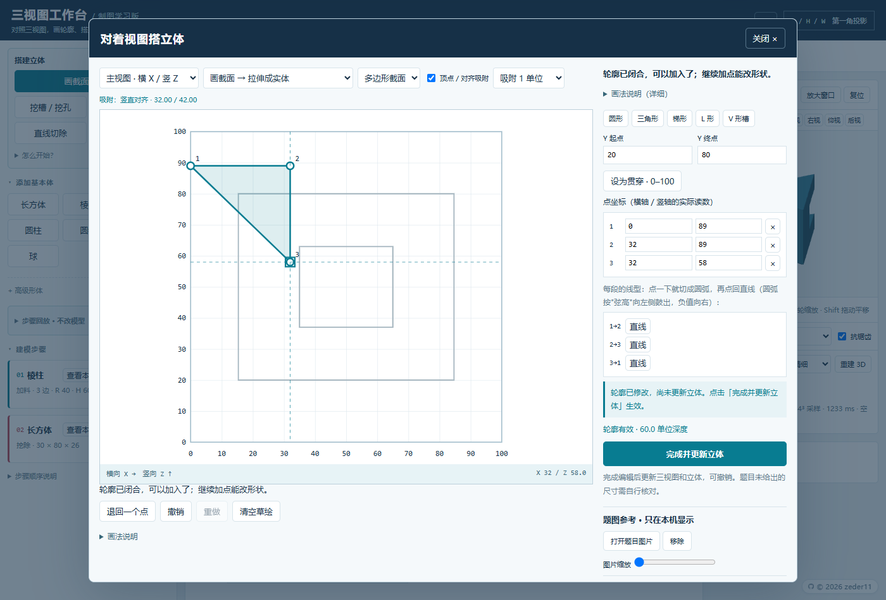
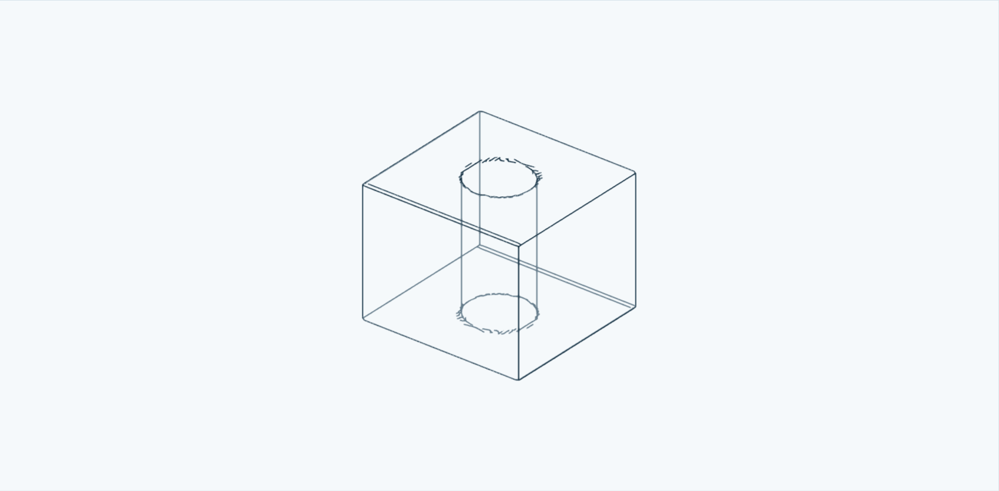

# Three-View Workbench — an engineering-drawing learning tool

A single-file, offline, zero-install web app for **descriptive geometry**. You build a part from
primitive solids and ordered boolean cuts, and the app renders the three orthographic views
(front / top / left, first-angle projection) plus an interactive 3D preview — so you can check
your reading of a drawing by reconstructing it instead of guessing.

The interface supports **English and Chinese**. Use the `EN` / `中文` button in the top-right corner;
the selected language is remembered locally and also applies to exported drawings.



## What changed in v0.0.2

This version improves 3D outlines and adds named records, language switching and candidate comparison.
The drafting geometry kernel, model format and examples remain compatible — all 100 projection
fingerprints match the existing baseline.

- **Clean model outlines.** Surface intersections and tangent silhouettes now come from the original
  primitives, with CSG ray visibility, removing the comb-like crossbars and gaps caused by voxel edges.
- **Hidden outlines are dashed along the actual polyline.** The old dash pattern was anchored to
  screen-space pixel coordinates, so at certain orbit angles a whole hidden edge disappeared or
  turned solid. Dashes now use accumulated projected arc length to keep their screen spacing even.
- **Dash phase is continuous along each polyline** (revision of this build). The first build restarted
  the pattern at every mesh segment, which looked like dense ticks when zoomed in and like a solid
  line when zoomed out; adjacent segments now share one accumulated arc length, so long edges, arcs and
  hole rims come out as a single clean dashed line, with a half-line-width patch at the joins.
- **Hidden edges are easier to read**: darker (#66808C), 1.5 px instead of 1.35 px, 12 px period
  (7 px on, 5 px off).
- **24-bit mesh depth buffer when WebGL2 is available** (was 16-bit), with a WebGL1 fallback.
  Outline visibility now uses the original CSG geometry independently of that buffer.
- **New 3D quality level `128³`** (~290k triangles) for a finer shaded surface. Rebuilding it still takes a
  few seconds. Outline clarity is independent of mesh resolution; the
  automatic mode is unchanged (42³ first, then 84³ when idle). Expanding the preview refines it to
  the current quality level.
- **New "records" panel**: saves the current model, 3D camera, display mode and a thumbnail under a
  name you type (e.g. `3-53`), in this browser's localStorage only — nothing is uploaded. Click a card
  to restore that state later. Portable copies still come from 保存模型 → JSON export.
- **Interface language switch (English / Chinese)**: the `EN` button in the top-right corner switches
  the whole interface at runtime and remembers the choice in localStorage. The exported SVG/PNG drawing
  follows the selected language; model files and its JSON format are untouched.
- **Improved "Explain this line" helper**: trace directly in a view or over a local reference image,
  specify solid or hidden edges, and add constraints from other views. Compare planar cuts, rectangular
  slots, view-axis or inclined holes, cylindrical additions and spherical recesses. Three preview views
  show added, removed and visibility-changed edges; bounded parameter refinement is available. Arc fitting
  uses every traced point. Only **Adopt this candidate** changes the model. Scores cover annotated evidence;
  unmarked views still need manual checking and a high score does not imply a unique solution.
- **Per-edge sketch arcs, with clean projection lines.** Each profile edge can be straight or circular
  with a signed sagitta. Authored arc metadata identifies continuous surfaces, so their short-chord seams
  are suppressed in drawings and 3D outlines while true corners and cuts remain. Clearing or replacing a
  sketch resets its arcs; model files preserve sagitta precision. Material geometry still uses short
  chords. Load `examples/rounded-profile.json` with Open model to try it.
- **Traces and reference images travel with the model.** Lines traced in Explain this line and the
  reference image overlaid on a view are written into the optional `annotations` field of the model JSON,
  so a page reload, a saved record or re-opening the file restores them. Files without annotations keep the
  old format byte for byte, and exported SVG / PNG still contain only the projected lines.
- Fixed three self-test scripts that pointed at a wrong path (development tree only).
- **Live preview while dragging.** Changing a dimension draws a low-resolution draft first (~0.2 s) and
  re-computes at full quality when you release. In a measured 0.65 s drag the old build refreshed once
  (after release); the new one refreshed four times, with no slowdown for the final image.
- **Keyboard shortcuts**: `Ctrl+S` save model, `Ctrl+O` open model, `Ctrl+Z` / `Ctrl+Y` undo and redo,
  `Esc` closes panels; click a shape card and press `Delete` to remove it (ignored while typing in a field).
- **Less clutter**: the sheet-helpers block in the right column collapses into a single row that shows
  which helpers are on; hint text and buttons are large enough to tap.
- **Very shallow arcs fit as arcs.** A three-point arc whose radius is far larger than the part, or whose
  centre falls outside the sheet, is no longer rejected as a straight line; choosing Arc with collinear
  points now explains why it cannot fit.
- **High sampling can be cancelled.** Switching to 640² / 960² shows "last time about X s" in the status bar
  and a Cancel button instead of making you wait blindly. Reference images gained **Fit to outline**, which
  snaps the drawing's ink box onto the model view's bounding box.
- Smoke-tested on Firefox (10 checks pass); earlier builds were only verified on Chromium / Edge.



## Why another CAD-ish toy?

Full CAD is the wrong tool while you are still learning to read drawings: you need to answer
"what solid would produce these three views?", not "how do I constrain this sketch?".
This app is deliberately small and use-case driven:

- **Sketch a section and extrude it** (triangle, trapezoid, L, V-slot, any non-self-intersecting polygon).
- **Sketch a section and cut it** — through, or to a given depth; circles become real cylinders.
- **Draw a line in a view and cut one side** — for cuts that project as a line.
- **Define a cutting plane by three points** — located across two views, no trigonometry.
- **Step replay** — see the model after each boolean step without touching undo history.
- **Overlay a photo of the problem** and calibrate it with two known points, then trace over it.
- **Point correspondence guides** — click a point, see the same point in the other two views and in 3D.
- **Solid / visible-outline / hidden-as-dashed** rendering, FXAA and optional high-resolution mesh
  (fast 42³, fine 84³, ultra 128³).

## Quick start

1. Download this repository (Code → Download ZIP) and unzip it.
2. Double-click `app/three-view-workbench.html`. That is the whole installation.
3. The sample model appears immediately. Drag on the 3D view to rotate; scroll to zoom.
4. Open **File → 打开模型** (open model) to load one of the `examples/*.json` files.

The interface ships in Chinese and English: the `EN` / `中文` button in the top-right corner switches
it at runtime and remembers the choice; exported drawings follow the selected language.

Everything runs locally. No server, no npm, no CDN, no telemetry, no network requests unless you
explicitly configure an AI provider and press the generate button.

Requirements: a recent Edge / Chrome / Firefox with WebGL. If you load the file over `file://` and a
provider rejects the origin, an optional tiny Node static server is included in the original
development tree (not required for the drafting features).

## How it works

- A ray-intersection kernel evaluates a CSG tree of convex primitives (`box`, `prism`, `pyramid`,
  `cylinder`, `cone`, `frustum`, `sphere`, and half-space `poly` cutters) analytically.
- The three views are extracted by sampling a 320² (configurable) grid of rays per view, then
  contour-tracing and sub-pixel refining the boundaries. Visible edges, hidden edges and silhouettes
  are separated by comparing neighbouring face ids.
- The shaded 3D preview is a marching-tetrahedra mesh. Outline modes use primitive surface intersections,
  tangent silhouettes and CSG ray visibility, independently of the mesh and drafting pipeline.
- Sketched sections are compiled into the same half-space `poly` primitives the kernel already
  understands, so drafting results stay consistent with hand-built models.

## Known limitations

These are real and documented on purpose:

- **Sampling-based, not exact CAD.** Features narrower than one sample cell can disappear; increase
  the drafting resolution if a slot or boss vanishes.
- Smooth junctions (e.g. cylinder meeting a hemisphere) may draw one extra edge.
- 3D outline curves are tessellated into line segments. General curved-surface intersections still use
  finite parameter-space tracing; very small or nearly tangent features may require checking.
- The 128³ level only refines the shaded mesh and still takes longer to rebuild.
- The 3D mesh is independent from, and coarser than, the drafting result. Use it for intuition only.
- Candidate comparison searches a limited family of constructions and nearby parameters. It does not
  recognize lines automatically or guarantee an optimum. Traces and the helper's reference images are
  temporary and are not included in model files or exported drawings.
- Two given views do not determine a unique solid. The app helps you build and check a candidate; it
  does not claim to derive "the" answer.
- The optional AI panel only produces a JSON description of primitives. Reading accuracy on real
  problem photos has not been validated, so treat its output as a draft to correct.
- Model units are abstract 0–100 work-volume units, not millimetres.

## Repository layout

```
app/three-view-workbench.html   the application (single file)
examples/*.json                 small original models you can open
docs/*.png                      screenshots
THIRD_PARTY_NOTICES.md          embedded FXAA licence notices
LICENSE                         PolyForm Noncommercial 1.0.0
```

## Development notes

This began as a personal study aid during an engineering-drawing course. I set the requirements,
used it on real homework, and reported what broke; most of the code was written with AI assistance
and reviewed through a test suite (geometry assertions, 100-model projection fingerprint regression,
and headless-browser interaction tests). The test suite lives in the development tree and is not
part of this release.

Bug reports with a screenshot and the model JSON are the most useful thing you can send.

## Licence

**PolyForm Noncommercial 1.0.0** — see [LICENSE](LICENSE). Copyright (c) 2026 zeder11.

You may use, study, modify, remix and share this project for any **noncommercial** purpose (personal
study, teaching, free redistribution), as long as the `Required Notice` line in [LICENSE](LICENSE)
stays with the project. **Commercial use is not permitted**, so the work cannot be resold, bundled
into a paid product, or put behind ads or paywalls.

The embedded FXAA shader keeps its upstream MIT/BSD notices in
[THIRD_PARTY_NOTICES.md](THIRD_PARTY_NOTICES.md); those third-party parts stay under their own
licences. The earlier v0.0.1 release remains MIT.
