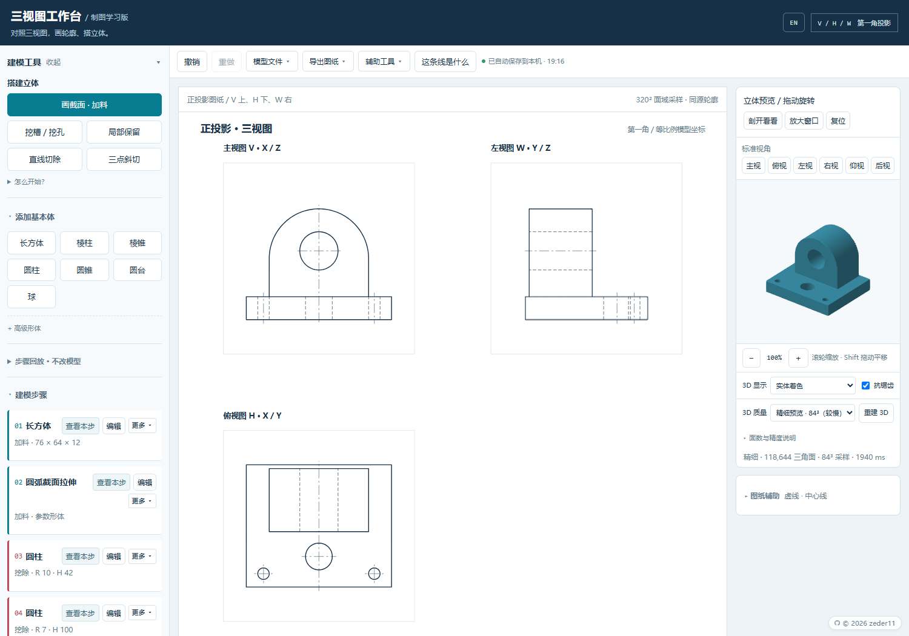
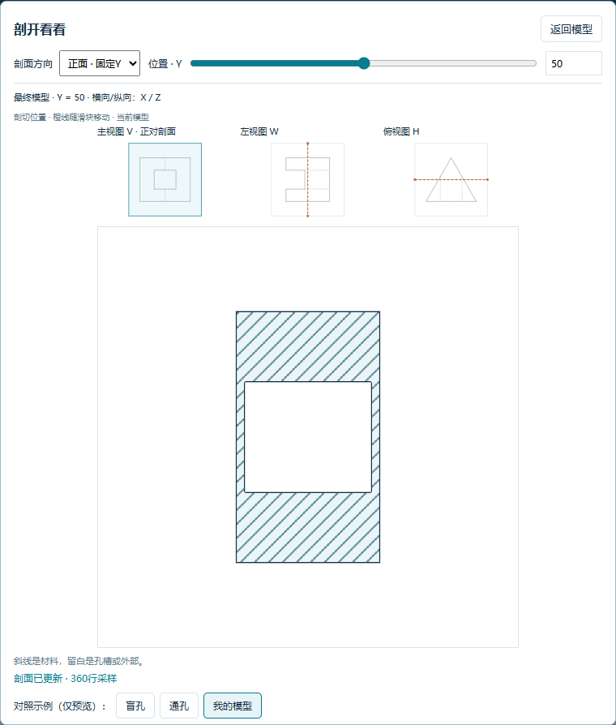

# Three-View Workbench · v0.6.1

An offline engineering-drawing study tool for building solids and checking orthographic views, centre lines and A–A full sections. Ordinary modeling needs no network or installation. AI modeling is optional.

[Open the workbench](app/three-view-workbench.html) · [中文](README.zh-CN.md) · [Complete guide](docs/guide.md) · [Release notes](RELEASE_NOTES.md)

## Start

1. Download `three-view-workbench.html` from the Release and open it in a modern browser, or extract the full ZIP and open `index.html`.
2. Load an example or model with primitives, line/arc sketches, extrusion, subtraction, local retention and plane cuts. Existing workbench JSON files remain compatible.
3. Compare the drawings and 3D model, inspect a section when needed, export editable JSON for backup, or PNG/SVG drawings.

## Features

| Feature | Purpose |
| --- | --- |
| Solid and sketch modeling | Ordered boolean steps, line/arc profiles, local retention, three-point plane cuts, undo and step replay |
| Drawings and outlines | First-angle views, visible/hidden lines, centre/symmetry lines, rotatable solids and 3D outlines |
| A–A full sections | Plane position, viewing direction, linked read-only 3D and drawing exports with hatching and centre lines |
| Line explanation | Locate an existing line on the solid, or trace evidence and compare candidate cuts; a match does not prove the whole answer |
| AI modeling | Generate from images/text or paste JSON from another AI; independent preview, review records and explicit source-review edit ranges |
| Saving | Autosave, named records, annotated model JSON, SVG/PNG and explicit model-only recovery for damaged annotations |

This release fixes tangent/arc outline and line-style errors, adds obround and full-section centre lines, and improves preview quality, interaction, API safety, recovery and source-review scope protection. See the [release notes](RELEASE_NOTES.md).

## AI and privacy

Ordinary modeling, projections, previews and exports run locally. Online generation, revision, reply updates and source review send the corresponding text, problem images or generated projections only when you invoke them.

Configure your own provider, model and API key. No key is bundled. “Remember key” stores it in plain text in this browser; otherwise it stays in page memory. Export does not write the application's key, but a model file can contain your saved reference images, annotations and descriptions. Check before sharing.

API endpoints require HTTPS, except loopback HTTP for local services. Remote HTTP, embedded URL credentials and API redirects are rejected. AI may misread drawings or spatial relations: check the independent preview, dimensions and structure before applying.

## Examples and help

- [Block with a bore](examples/box-with-hole.json), [arc plate](examples/ai-arc-plate.json), [bracket and centre lines](examples/centerlines-bracket.json). Download JSON and use Import model file.
- [17 independently constructed outline examples](examples/complex-outlines/README.md).
- [Complete English guide](docs/guide.md) · [完整中文手册](docs/guide.zh-CN.md).

## Limits

This is a study/checking tool, not precision CAD or an automatic answer system. Meshes and parts of projection calculation have sampling limits; inspect very thin material and small features at higher quality. Section hatching follows actual material; special drafting conventions for ribs and similar features are not inferred automatically.

AI explanations, confidence, candidate scores and local dimension checks do not certify a match to the problem. Review scope guards input-step parameters; later booleans can still affect related final material. Browser storage is not a file backup: export JSON regularly.

## License

[PolyForm Noncommercial 1.0.0](LICENSE). The license text controls permissions and restrictions. See [third-party notices](THIRD_PARTY_NOTICES.md).
