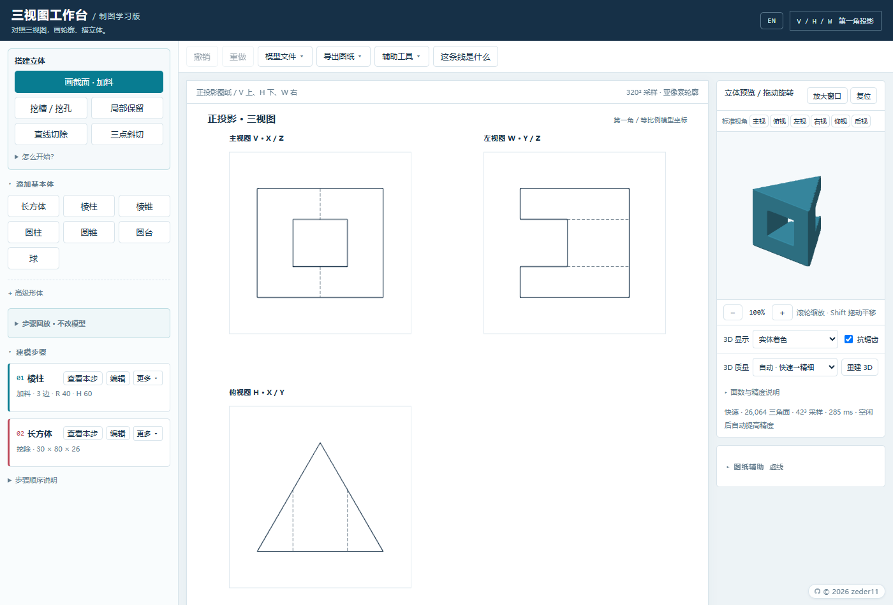
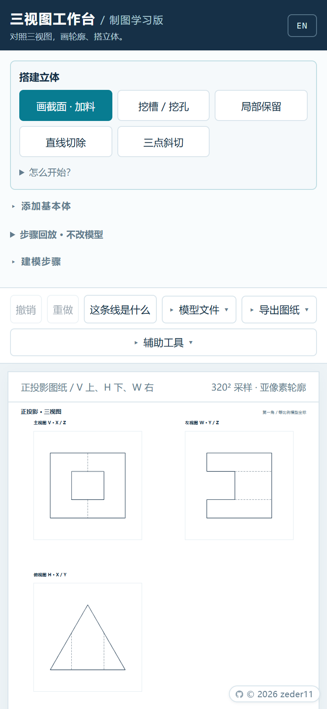
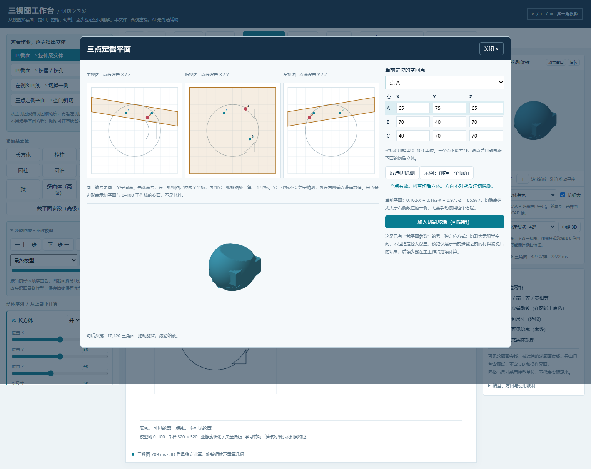

# v0.4.0: finish the editing workflow (2026-10-31)

The toolbar now has Model files, Export drawing and Tools menus, with outside-click/Escape dismissal and viewport-aware placement. Legacy arc upgrades appear under Model files → Legacy files only when verified groups exist; upgrades remain explicit and undoable.

Steps show compact dimension summaries. Edit one step to expand its parameters; other steps close, and new primitives open for editing. Reorder/delete actions live under each step's More control. Sketch adjustments use “Use in outline”, followed by “Finish & update model”, with a clear pending-update message. Undoing back to the original outline clears that message. A persistent mobile Sketch button returns to the drawing without losing edits or previews. Geometry, formats and full-precision saving are unchanged. HTML: 523598 bytes, SHA256 prefix 64A60351. Current acceptance is tracked in the root progress file; physical-device follow-up remains deferred. No online publication was performed.

Local acceptance passed: all 32 browser suites, 8 unwrapped workflow checks on both development/release files, 19 existing-function release checks and 25 desktop checks of the refreshed device entry; no page errors. Geometry code is byte-identical to the pre-change backup, so unrelated unit/fingerprint calculations were not repeated. Comments and documentation are updated.

---

# 历史：v0.4.0: a simpler workspace (2026-10-31)

Compact modeling actions and a shorter mobile toolbar bring the drawing into view sooner. Long drawing instructions, step-order notes and rendering explanations now expand on demand. Coordinates, depth, display modes and mesh quality remain directly editable. The previous outline-retention action is now labeled “Keep a section”.

Arc joins show one compact row per arc, with “Keep endpoints” and “Keep radius…” as the main actions. Single-end controls and external tangency diagnostics expand when needed. A pending preview focuses the panel on its result; dimensions, contact coordinates, movement amounts and dependent steps remain visible before applying to the draft. Geometry, full-precision persistence, undo and file formats are unchanged. HTML: 512815 bytes, SHA256 prefix 8152575B. Current acceptance is recorded below.

Local acceptance: all 31 browser suites ultimately passed, including two reruns after adapting obsolete UI expectations; initial logs and rerun evidence are preserved. Both development and release files passed 10 new UI checks; the release also passed 19 existing-function checks, and the refreshed device entry passed 25 desktop checks. No page errors. Geometry code is unchanged, so unrelated unit/fingerprint calculations were not repeated. Comments and documentation are updated. Only the deferred physical-device follow-up remains.

---

# 历史：v0.4.0: solve both ends of an arc together (2026-10-31)

Single-end adjustments can no longer break existing tangency at the other end. For an arc between two lines, first check whether both joins can be satisfied with fixed endpoints. If not, preview moving both contacts along their original lines while keeping the current radius. Other points, line directions and depth stay fixed. The preview lists coordinates, movement distances, line lengths and both angles before anything changes. Confirm to the draft, then commit; cancel, two-level undo/redo and persistence are supported.

Try the [two-end exercise](examples/adjust-both-joins.json), editing arc 2 in step 1. Fixed endpoints conflict; moving the contacts preserves R20 and satisfies both joins. Review homework dimensions before moving points. Insufficient line space, reversed bulge, unsupported semicircles/major arcs and invalid profiles are rejected. Profiles with their own persistent constraints must remove them before moving contacts; downstream steps still preview and update atomically. This remains a one-time adjustment with no file-format change. HTML: 510739 bytes, SHA256 prefix 789D9133. Current acceptance is tracked in the root progress file. Physical-device follow-up remains deferred; no online publication was performed.

Local acceptance passed: 25 unit scripts, 30 browser suites, 100 unchanged fingerprints, 17 targeted geometry checks, 13 feature checks on each development/release file, 19 existing-function release checks and 25 desktop checks of the refreshed device entry; no page errors. Comments and documentation are updated.

---

# 历史：v0.4.0: adjust adjacent line/arc joins (2026-10-31)

The sketch now identifies tangent joins and real corners within the same closed profile. Keep the current shape by default, or preview a smooth adjustment before applying it to the draft and committing to the workbench. Orange dashes show the candidate without changing the draft or model. Editing invalidates a pending preview; commit is disabled until the preview is applied or cancelled.

Endpoints, straight segments and depth stay fixed; only the selected arc's sagitta/radius changes. The other endpoint's angle change is shown. This is a one-time adjustment, not a persistent constraint. Impossible fixed-endpoint solutions, bulge reversals, semicircles/major arcs and invalid profiles are rejected without changing geometry. Legacy chords need an explicit upgrade first. Draft undo/redo, atomic dependent-step updates and full-precision persistence are supported without a new file format.

Try the [corner adjustment exercise](examples/adjust-smooth-join.json): edit step 1, preview point 2 or 3, apply and compare the views. The [exact tangent example](examples/smooth-arc-transition.json) remains available. HTML: 501042 bytes, SHA256 prefix 46CA3C14. Current acceptance is recorded below.

Local acceptance passed: 25 unit scripts, 30 browser suites, 100 unchanged fingerprints, 8 new-feature checks on both development/release files, 19 final existing-function release checks and 23 desktop checks of the device entry, with no page errors. Comments and usage/acceptance documentation are updated. Only the deferred physical-device follow-up remains.

---

# 历史：v0.4.0: smooth seams and release-triggered outlines (2026-10-31)

Exactly tangent line/arc joins no longer create internal sheet lines; real corners, cuts and outer boundaries remain. Try the [smooth transition example](examples/smooth-arc-transition.json). While a mouse or touch pointer remains down, the preview stays shaded even if movement pauses. Outlines resume after the last pointer ends, including cancellation or focus loss. Orbiting does not rebuild geometry.

Also fixes valid 0.1 depth/radius values rejected by floating-point rounding, out-of-domain retention hatching, and a tangent dialog incorrectly calling retained models v5. Format selection is unchanged: retained models remain v6. HTML: 488837 bytes, SHA256 prefix 38EC7F65. Current evidence is recorded below.

Local acceptance passed: 24 unit scripts, 29 browser suites, 100 unchanged fingerprints, 12 targeted checks on both development/release files and 19 existing-function checks on the actual release, with no page errors. Only physical-device follow-up remains.

Local profile retention instructions and historical acceptance notes follow.

# v0.4.0: local profile retention (2026-10-31)

New in v0.4.0. Choose “Keep outline → cut outside”, draw a circle or a closed polygon (including concave and arc profiles), and set the depth interval. The operation removes existing material outside the outline only in that interval, preserving prior holes and slots. It applies to all earlier material; later additions follow normal step order. Editing, undo, replay and persistence are supported.

Try [cylinder reduction](examples/local-retain-cylinder.json) or [box reduction](examples/local-retain-box.json). Models containing this operation export as v6 and require this updated build. Other models retain their existing v3/v4/v5 formats. Acceptance status is tracked at the top of the root progress README. Historical device reports below apply to the earlier HTML only.

Local acceptance passed: 23 unit scripts, 28 browser suites, 100 unchanged fingerprints and 26 new geometry checks. Development and release HTML each passed 10 feature checks; the actual release also passed 19 existing-function checks, with no page errors. HTML: 483133 bytes, SHA256 prefix 66E31930.

# Historical: v0.4.0 locally finalized (2026-10-31)

Both closing tasks are complete: final acceptance of existing functionality, and testing on desktop browsers (Edge) and two mobile devices. The local release file is `app/three-view-workbench.html`; no online publication was performed. Spatial ellipse contact and general surface constraints move to future exploration and are not release blockers. The 128-shape capacity and sampling limits remain.

Existing functionality passed 19 final release checks on 2026-10-31, including 12 standard-view line comparisons across both example models and their legacy/native forms. Offline modeling and trace scoring also passed with no page errors. Both mobile devices passed 13 automatic checks: touch gestures, orientation/layout, actual download/reimport and sustained-use stability were all confirmed. Mobile automatic checks used 320 projection / 42³ fast mesh. Product HTML is unchanged.

Historical batch notes follow. Their older pending-feature lists have been superseded by this frozen scope. Current evidence is recorded below.

# Historical: v0.4.0 development batch 10: projected ellipses and sphere contact

Tilted cylinder end rims now have analytic ellipse projection checks for tangency, crossings and gaps, with a sketch reference overlay. They are explicitly 2D projection checks and offer no solid tangent construction or persistent binding. Degenerate or nearly edge-on projections are excluded. Try the [ellipse projection example](examples/projected-ellipse-check.json), then edit step 2.

Sphere references support tangent construction and persistent constraints only when the sketch depth contains the sphere-center plane. Radius/center changes update contacts; depth changes are validated, with invalid updates rolled back. v5 export/import, reloads and saved records preserve stable references. Try the [sphere contact example](examples/sphere-tangent-contact.json), changing radius 20 to 22. Use this batch or later to edit sphere constraints.

Validation: 22 unit scripts, 27 browser suites and 100 unchanged fingerprints, including 13 new analytic and 9 browser checks. GeometryKernel, legacy geometry and both drawing baselines are unchanged. Spatial ellipse contact, general surface constraints, other near intersections, real phones and other browsers remain pending. Checklist item 4 stays open; this is still a development build. Historical notes follow.

# v0.4.0 development batch 9: connected arc endpoint updates

A tangent line contact can now drive an adjacent arc sharing the same sketch vertex, with an explicit fixed-sagitta policy. The other endpoint, signed height and bulge direction remain; the center and radius are recalculated. Confirmation and constraint text explain this. Adding an arc to an existing constraint requires “Enable connected arc updates…”. A reference circle → connected arc → downstream tangent chain supports preview, atomic commit and undo. Invalid changes roll back; legacy chords require an explicit upgrade. Smooth tangency between adjacent curves and fixed-radius updates are not added.

Try the [linked arc example](examples/connected-arc-tangent.json): import it and change the first circle radius from 20 to 22. Policy survives v5 export/import, saved records and reloads; use this batch or later. Validation: 21 unit scripts, 26 browser suites and 100 unchanged fingerprints, including 13 numerical and 10 browser checks for this feature. GeometryKernel and both drawing baselines are unchanged.

Ellipse/general-surface tangency, other near intersections, real phones and other browsers remain pending. Checklist item 4 stays open; this is still a development build. Historical notes follow.

# v0.4.0 development batch 8: native arc endpoint parity

Fixes exterior points near native arc endpoints being classified as material. Arcs and lines now share half-open crossing rules; conservative tight bounds are restored for native extrusions. Points, arc heights, depths and file formats are unchanged: unconstrained native models remain v4, constrained models v5. Legacy chord models retain their original geometry unless explicitly upgraded.

Validation: 20 unit scripts, 25 browser suites and 100 unchanged v0.4.0 fingerprints; 10 independent analytic checks and 6 browser checks. Across legacy/native versions of the two example models, 12,000 broad field samples and all three 320-resolution sheet paths are unchanged. Targeted native endpoint predicates are corrected; changed 4-24 3D visibility segmentation is checked against the existing coverage budget. No baseline update. Try the [native endpoint example](examples/native-endpoint-profile.json).

Checklist item 4 remains open: connected arc endpoint updates, ellipse/general-surface tangency and other near intersections are pending, as are real phones and other browsers. This is still a development build. Historical notes follow.

# v0.4.0 development batch 7: persistent tangency

Use “Keep tangent” in sketch tangency checks to save a driving point, contact point, branch and stable circle/arc reference. Moving the driver or changing the reference center, radius or arc height updates dependent steps. Orange dashed outlines preview linked changes; one workspace undo restores the transaction. Invalid updates are blocked or rolled back. Removing a constraint preserves coordinates. Supported: straight segments against circles/native arcs in the same view with overlapping depth. Connected arc endpoints and general surface tangency remain pending.

Models with constraints export as **v5**; saved records and reloads preserve them. Older apps may ignore constraints: continue in this batch or later. Unconstrained native profiles remain v4 and ordinary models v3. Try the [persistent tangent example](examples/persistent-tangent.json), then change the circle radius from 20 to 22. Validation: 19 unit scripts, 24 browser suites and 100 unchanged batch-5 fingerprints. Remaining: complex curves/numerical boundaries, real phones and other browsers. This is still a development build. Historical notes follow.

# v0.4.0 development batch 6

Conservative spatial bounds, ordered material-state short circuits, occlusion ray filtering and exact-position caching reduce work while preserving line arrays and source results. Native arcs retain full-domain fallback for endpoint numerical compatibility.

Existing-line explanations now run in a persistent worker, with cancellation, model/trace invalidation, bounded query caching and retryable failures. Median of five alternating local samples: legacy 4-24 feature construction plus one view 1090→284ms, 4-25 297→153ms. These are stage timings, not whole-page or phone guarantees. Validation: 18 unit scripts, 23 browser suites, 100 unchanged batch-5 fingerprints. Persistent constraints, complex curves and real-device testing remain pending. Historical notes follow.

# v0.4.0 development batch 5

Front/top/left sheet paths were checked against the corresponding standard 3D directions. Fixes cover smooth cylinder/sphere seams, legacy sketch partition edges, missing hidden intersections, silhouette visibility and camera-angle rounding. Material, dimensions and physical rays stay unchanged.

Try `examples/smooth-cylinder-sphere.json` and `examples/intersecting-cylinders.json` in 3D X-ray outline mode and a standard view. Agreement is checked within the declared projection sampling budget; tiny features still need higher precision. Validation: 17 unit scripts, 22 browser suites, 100 cases against a separately reviewed v0.4.0 baseline; the historical baseline is retained. Performance, persistent constraints, complex curves and real-device testing remain pending. Historical notes follow.

# v0.4.0 development batch 4

The sketch editor now checks nearby line/circle or line/arc tangency, distinguishing crossings, gaps and extension-only contacts. **Construct tangent…** shows coordinates and movement before applying a reversible draft edit. The reference circle and one endpoint stay fixed. Upgrade legacy chord arcs first. Shallow real cuts no longer lose their edges, and exact tangent contacts no longer gain rounding-induced seams. Try `examples/near-tangent-demo.json` and edit its second step.

This is a one-time construction: recheck after later edits. Persistent constraints, spatial pruning, complete 2D/3D line agreement and real-device testing remain pending. Native profiles still export as v4, which older apps cannot read. Validation: 16 unit scripts, 21 browser suites, 100 unchanged existing projection fingerprints. Historical notes follow.

# v0.4.0 development batch 3

New sketches with arcs use one native line/arc extrusion, including concave profiles with multiple material intervals. Orthographic views and 3D outlines share the analytic boundary. Old files retain their geometry. Use **Upgrade legacy arcs** to check and convert complete, matching sketch groups; confirmation and undo are supported. Example: `examples/native-rounded-profile.json`.

**Models containing native profiles export as v4 and cannot be read by older apps. Keep the original files.** Other models still export as v3. Background outlines, capacity 128 and caching are implemented. Tangent constraints, spatial pruning and line-by-line view validation remain pending. Meshes and drawn lines still use sampling; performance did not improve across all stages for 4-25.

Validation: 15 unit scripts, 20 browser suites and 100 unchanged existing projection fingerprints. Historical batch and v0.3.0 notes follow.

Batch 2 added background outline calculation with an interactive shaded preview. Native arcs were still pending at that stage.

# v0.4.0 development batch 1

Cross-step arc seams fixed; internal capacity 128; mesh evaluation cached. Native arc extrusion and tangent construction remain pending. Background feature lines are implemented in batch 2. Earlier feature notes follow.

---

# Three-View Workbench — an engineering-drawing learning tool

A single-file, offline, zero-install web app for **descriptive geometry**. You build a part from
primitive solids and ordered boolean cuts, and the app renders the three orthographic views
(front / top / left, first-angle projection) plus an interactive 3D preview — so you can check
your reading of a drawing by reconstructing it instead of guessing.

The interface supports **English and Chinese**. Use the `EN` / `中文` button in the top-right corner;
the selected language is remembered locally and also applies to exported drawings.

<p align="center"> </p>


## What changed in v0.3.0

The main workflow is unchanged (build → read the three views → trace a line → compare candidates →
preview the difference → adopt → replay steps). This release closes the gaps where students could
only guess, plus two feel/reliability problems. Model format, kernel and examples stay compatible
(all 100 projection fingerprints match v0.2.0).

- **When several candidates tie, the panel now says which view and which region to trace next.**
  Ties are common (the two directions of a plane cut project identically in the same view). The panel
  scans the candidates' three views, picks the view and region where they differ most, and writes e.g.
  "these candidates look the same in the front view; the largest difference is in the middle of the
  left view" / "tracing one more line here separates 2 candidate pairs". That region is outlined in amber
  on the drawing, and a **Trace here** button switches to the suggested view and starts a new annotation —
  no manual view picking. If all three views are identical it says so instead: "the three views cannot
  distinguish these constructions; you need dimensions, the problem text, or another condition."
- **Large-radius shallow arcs are no longer silently shrunk into small holes.** When the fitted radius
  exceeds what the primitives can build (> 60, or the centre falls outside the sheet), those candidates are
  marked *outside the constructible range of the current primitives* and disabled; preview reports it
  instead of showing a low-scoring candidate built from a clamped radius.
- **3D drag no longer sticks at the vertical limit.** Rotation used the pointer-down height as its anchor
  and clamped at ±86°, so overshooting and dragging back had to spend the overshoot first. The anchor is
  now rebased every frame. Measured reversal dead zone: 30 px → 0; per-frame interval median 6.1 ms,
  p95 11.8–12 ms.
- **Autosave failures are reported once**: "Local autosave failed — use *Save model* to export a JSON backup."
- **A row of standard-view buttons above the 3D preview**: front / top / left / right / bottom / back.
  One click eases the camera (0.3 s) to that direction of the first-angle set (front looks along −Y,
  top along +Z, left along −X, …). Zoom is kept, pan recentres, and dragging during the animation
  interrupts it. Much faster than hunting for the angle when you want to check "is this the view in my
  problem sheet?".
- **Replay diff**: while replaying a step, cyan marks lines this step added, orange marks lines it removed,
  purple marks solid/hidden changes, and the panel counts them (added / removed / visibility). Exported PNG/SVG
  stay clean; untick `Diff vs previous step` to see the step on its own.
- **Less clutter on screen, plainer saving and error wording.** Below 730 px the primitive palette and the
  shape list start collapsed and the helper paragraph is hidden, so the sheet is on the first screen of a
  390×844 phone (sidebar 450 px → 352 px); the desktop layout is unchanged. The toolbar now reads
  **Export model file / Import model file / Local records**, and a quiet “Autosaved locally · 20:31” line
  reports success without a dialog. Import failures and bad half-space input stay in a red bar that states the
  reason and “the current model is unchanged” until you close it or fix the input; success toasts still fade.
  Polyhedron and cutting-plane parameters moved under “Advanced primitives”, the face-count note is collapsed,
  parameters read “X position (left–right) / Y position (front–back) / Z position (up–down)”, and “add / sub”
  became “Add material / Remove material”. No geometry, file-format or palette changes in this pass.
- **Vertical rotation now reaches ±90° instead of ±86°**: elevation used to be clamped at ±1.5 rad
  (85.94°), 4° short of straight up/down. It is clamped at ±π/2 now, so dragging up stops exactly on the
  top view with no degenerate basis vectors or flicker. Flipping past the pole is still not allowed —
  it only shows the same view upside down; use **Back** to look at the other side.
- **Sketching is undoable now: `Ctrl+Z` only touches sketch points, and Clear/presets can be undone.** The sketch pad keeps its own
  undo stack (Undo/Redo buttons plus `Ctrl+Z` / `Ctrl+Shift+Z`), and while a dialog is open the shortcut no longer rewrites the
  model history behind it. Clearing the sketch or applying a preset offers an "applied L-shape · Undo" note.
  Points look the same but their hit area is about 24×24 px, the dragged point and its coordinate row light up, and pressing
  near a point starts a drag instead of adding a new point. Marker points can be dragged on the sheet (snapping still applies
  on release) or deleted one at a time from the panel. On narrow screens the next-step hint sits right under the drawing with
  a sticky "Back one point | Add to workbench" bar, and the static how-to text folds into "How to draw".
- **`Delete` removes the step, not a fragment**: an L-shaped sketch is split into several convex blocks behind one card; `Delete` now removes the whole step ("Deleted this step") while a plain box/cylinder still deletes only itself. Sketch-group and three-point cutting-plane cards also get the selection outline now.
- **Clear asks first, loading an example is undoable**: clearing a non-empty model asks once, and replacing the current model with an example shows "Replaced the current model" with an *Undo* button.
- **View this step**: every solid card, sketch card and cutting-plane card has a small *View this step* button. It jumps the three views to that step and turns on *Diff vs previous step* automatically (new lines cyan, vanished lines red-orange, visibility flips purple), with a *Back to final model* button in the banner; on narrow screens the sheet scrolls back into view. Clicking the card itself never triggers it, so dragging sliders cannot fire it by accident.
- **Closing an unsaved sketch asks first**: if you have drawn points but not applied them yet, the close button or `Esc` shows *This sketch has not been added yet; closing will discard it* with *Keep editing* / *Discard and close*. Empty sketches close silently.
- **English UI completed**: after switching to EN, the invisible strings (`title`, `aria-label`, `placeholder`, `alt`) are translated too — about 70 more entries. Slider labels keep the `slider` wording for screen readers, live snap hints and the 3D note read as whole sentences, and there is no more mixed Chinese/English or glued text such as `supersamplingon`.
- **Errors no longer cost work, and narrow screens show you the next step.** Failures that could lose work (failed
  autosave, failed export, an unreadable local record) now stay in a red bar under the toolbar with an "Export backup"
  button instead of vanishing after a few seconds; an export failure says the model is still there and can be retried.
  After adding a shape on a narrow screen, the success toast offers "Edit size", which expands the shape list and
  focuses that card. The sketch pad shows one line telling you what to do next ("2 more points", "step 2: click the
  circle direction", "closed, ready to add") and explains why the main button is disabled. The narrow toolbar groups
  export/import actions under "File" and "Sheet & export", keeping Undo/Redo and "Explain this line" always visible.
  Copy and punctuation are tidied up as well.

## What changed in v0.2.0

This version improves 3D outlines and adds named records, language switching and candidate comparison.
The drafting geometry kernel, model format and examples remain compatible — all 100 projection
fingerprints match the existing baseline.

- **Clean model outlines.** Surface intersections and tangent silhouettes now come from the original
  primitives, with CSG ray visibility, removing the comb-like crossbars and gaps caused by voxel edges.
- **Hidden outlines are dashed along the actual polyline.** The old dash pattern was anchored to
  screen-space pixel coordinates, so at certain orbit angles a whole hidden edge disappeared or
  turned solid. Dashes now use accumulated projected arc length to keep their screen spacing even.
- **Dash phase is continuous along each polyline** (revision of this build). The first build restarted
  the pattern at every mesh segment, which looked like dense ticks when zoomed in and like a solid
  line when zoomed out; adjacent segments now share one accumulated arc length, so long edges, arcs and
  hole rims come out as a single clean dashed line, with a half-line-width patch at the joins.
- **Hidden edges are easier to read**: darker (#66808C), 1.5 px instead of 1.35 px, 12 px period
  (7 px on, 5 px off).
- **24-bit mesh depth buffer when WebGL2 is available** (was 16-bit), with a WebGL1 fallback.
  Outline visibility now uses the original CSG geometry independently of that buffer.
- **New 3D quality level `128³`** (~290k triangles) for a finer shaded surface. Rebuilding it still takes a
  few seconds. Outline clarity is independent of mesh resolution; the
  automatic mode is unchanged (42³ first, then 84³ when idle). Expanding the preview refines it to
  the current quality level.
- **New "records" panel**: saves the current model, 3D camera, display mode and a thumbnail under a
  name you type (e.g. `3-53`), in this browser's localStorage only — nothing is uploaded. Click a card
  to restore that state later. Portable copies still come from 「保存模型」 → JSON export (renamed **Export model file** in v0.3.0).
- **Interface language switch (English / Chinese)**: the `EN` button in the top-right corner switches
  the whole interface at runtime and remembers the choice in localStorage. The exported SVG/PNG drawing
  follows the selected language; model files and its JSON format are untouched.
- **Improved "Explain this line" helper**: trace directly in a view or over a local reference image,
  specify solid or hidden edges, and add constraints from other views. Compare planar cuts, rectangular
  slots, view-axis or inclined holes, cylindrical additions and spherical recesses. Three preview views
  show added, removed and visibility-changed edges; bounded parameter refinement is available. Arc fitting
  uses every traced point. Only **Adopt this candidate** changes the model. Scores cover annotated evidence;
  unmarked views still need manual checking and a high score does not imply a unique solution.
- **Per-edge sketch arcs, with clean projection lines.** Each profile edge can be straight or circular
  with a signed sagitta. Authored arc metadata identifies continuous surfaces, so their short-chord seams
  are suppressed in drawings and 3D outlines while true corners and cuts remain. Clearing or replacing a
  sketch resets its arcs; model files preserve sagitta precision. Material geometry still uses short
  chords. Load `examples/rounded-profile.json` with Open model to try it.
- **Traces and reference images travel with the model.** Lines traced in Explain this line and the
  reference image overlaid on a view are written into the optional `annotations` field of the model JSON,
  so a page reload, a saved record or re-opening the file restores them. Files without annotations keep the
  old format byte for byte, and exported SVG / PNG still contain only the projected lines.
- Fixed three self-test scripts that pointed at a wrong path (development tree only).
- **Live preview while dragging.** Changing a dimension draws a low-resolution draft first (~0.2 s) and
  re-computes at full quality when you release. In a measured 0.65 s drag the old build refreshed once
  (after release); the new one refreshed four times, with no slowdown for the final image.
- **Keyboard shortcuts**: `Ctrl+S` save model, `Ctrl+O` open model, `Ctrl+Z` / `Ctrl+Y` undo and redo,
  `Esc` closes panels; click a shape card and press `Delete` to remove it (ignored while typing in a field).
- **Less clutter**: the sheet-helpers block in the right column collapses into a single row that shows
  which helpers are on; hint text and buttons are large enough to tap.
- **Very shallow arcs fit as arcs.** A three-point arc whose radius is far larger than the part, or whose
  centre falls outside the sheet, is no longer rejected as a straight line; choosing Arc with collinear
  points now explains why it cannot fit.
- **High sampling can be cancelled.** Switching to 640² / 960² shows "last time about X s" in the status bar
  and a Cancel button instead of making you wait blindly. Reference images gained **Fit to outline**, which
  snaps the drawing's ink box onto the model view's bounding box.
- Smoke-tested on Firefox (10 checks pass); earlier builds were only verified on Chromium / Edge.


## Why another CAD-ish toy?

Full CAD is the wrong tool while you are still learning to read drawings: you need to answer
"what solid would produce these three views?", not "how do I constrain this sketch?".
This app is deliberately small and use-case driven:

- **Sketch a section and extrude it** (triangle, trapezoid, L, V-slot, any non-self-intersecting polygon).
- **Sketch a section and cut it** — through, or to a given depth; circles become real cylinders.
- **Draw a line in a view and cut one side** — for cuts that project as a line.
- **Define a cutting plane by three points** — located across two views, no trigonometry.
- **Step replay** — see the model after each boolean step without touching undo history.
- **Overlay a photo of the problem** and calibrate it with two known points, then trace over it.
- **Point correspondence guides** — click a point, see the same point in the other two views and in 3D.
- **Solid / visible-outline / hidden-as-dashed** rendering, FXAA and optional high-resolution mesh
  (fast 42³, fine 84³, ultra 128³).



## Quick start

1. Download this repository (Code → Download ZIP) and unzip it.
2. Double-click `app/three-view-workbench.html`. That is the whole installation.
3. The sample model appears immediately. Drag on the 3D view to rotate; scroll to zoom.
4. Use **Import model file** in the toolbar to load one of the `examples/*.json` files.

The interface ships in Chinese and English: the `EN` / `中文` button in the top-right corner switches
it at runtime and remembers the choice; exported drawings follow the selected language.

Everything runs locally. No server, no npm, no CDN, no telemetry, no network requests unless you
explicitly configure an AI provider and press the generate button.

Requirements: a recent Edge / Chrome / Firefox with WebGL. If you load the file over `file://` and a
provider rejects the origin, an optional tiny Node static server is included in the original
development tree (not required for the drafting features).

## How it works

- A ray-intersection kernel evaluates a CSG tree of convex primitives (`box`, `prism`, `pyramid`,
  `cylinder`, `cone`, `frustum`, `sphere`, and half-space `poly` cutters) analytically.
- The three views are extracted by sampling a 320² (configurable) grid of rays per view, then
  contour-tracing and sub-pixel refining the boundaries. Visible edges, hidden edges and silhouettes
  are separated by comparing neighbouring face ids.
- The shaded 3D preview is a marching-tetrahedra mesh. Outline modes use primitive surface intersections,
  tangent silhouettes and CSG ray visibility, independently of the mesh and drafting pipeline.
- Sketched sections are compiled into the same half-space `poly` primitives the kernel already
  understands, so drafting results stay consistent with hand-built models.

## Known limitations

These are real and documented on purpose:

- **Sampling-based, not exact CAD.** Features narrower than one sample cell can disappear; increase
  the drafting resolution if a slot or boss vanishes.
- Smooth junctions (e.g. cylinder meeting a hemisphere) may draw one extra edge.
- 3D outline curves are tessellated into line segments. General curved-surface intersections still use
  finite parameter-space tracing; very small or nearly tangent features may require checking.
- The 128³ level only refines the shaded mesh and still takes longer to rebuild.
- The 3D mesh is independent from, and coarser than, the drafting result. Use it for intuition only.
- Candidate comparison searches a limited family of constructions and nearby parameters. It does not
  recognize lines automatically or guarantee an optimum. Traces and the helper's reference images are
  temporary and are not included in model files or exported drawings.
- Two given views do not determine a unique solid. The app helps you build and check a candidate; it
  does not claim to derive "the" answer.
- The optional AI panel only produces a JSON description of primitives. Reading accuracy on real
  problem photos has not been validated, so treat its output as a draft to correct.
- Model units are abstract 0–100 work-volume units, not millimetres.

## Repository layout

```
app/three-view-workbench.html   the application (single file)
examples/*.json                 small original models you can open
docs/*.png                      screenshots
THIRD_PARTY_NOTICES.md          embedded FXAA licence notices
LICENSE                         PolyForm Noncommercial 1.0.0
```

## Development notes

This began as a personal study aid during an engineering-drawing course. I set the requirements,
used it on real homework, and reported what broke; most of the code was written with AI assistance
and reviewed through a test suite (geometry assertions, 100-model projection fingerprint regression,
and headless-browser interaction tests). The test suite lives in the development tree and is not
part of this release.

Bug reports with a screenshot and the model JSON are the most useful thing you can send.

## Licence

**PolyForm Noncommercial 1.0.0** — see [LICENSE](LICENSE). Copyright (c) 2026 zeder11.

You may use, study, modify, remix and share this project for any **noncommercial** purpose (personal
study, teaching, free redistribution), as long as the `Required Notice` line in [LICENSE](LICENSE)
stays with the project. **Commercial use is not permitted**, so the work cannot be resold, bundled
into a paid product, or put behind ads or paywalls.

The embedded FXAA shader keeps its upstream MIT/BSD notices in
[THIRD_PARTY_NOTICES.md](THIRD_PARTY_NOTICES.md); those third-party parts stay under their own
licences. The earlier v0.1.0 release remains MIT.
