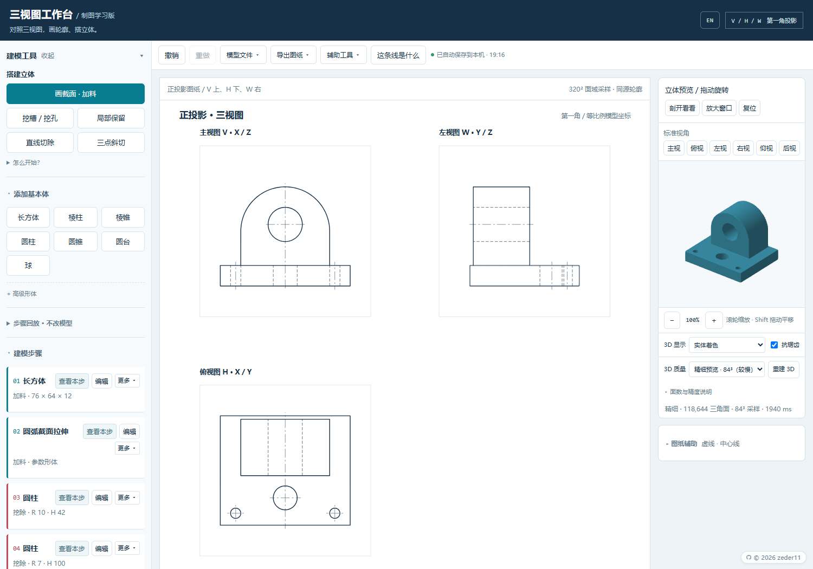
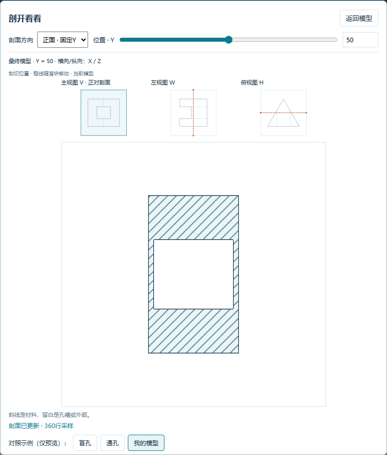

# 三视图工作台 · v0.6.1

离线工程制图学习工具：搭建立体，核对三视图、中心线和 A–A 全剖视图，查看线条对应的实体位置。普通建模无需联网或安装；AI 建模为可选功能。

[打开工作台](app/three-view-workbench.html) · [English](README.md) · [完整使用手册](docs/guide.zh-CN.md) · [本版更新](RELEASE_NOTES.zh-CN.md)

## 开始使用

1. 下载 Release 中的 `three-view-workbench.html`，双击用现代浏览器打开；或解压完整 ZIP，打开 `index.html`。
2. 从示例开始，或画截面后拉伸、挖槽、局部保留、切斜面；旧模型 JSON 可直接导入。
3. 在三视图与立体之间核对结构，需要看内部时打开「剖开看看」。导出 JSON 保存可编辑作业，导出 PNG／SVG 得到图纸。

## 主要功能

| 功能 | 用途 |
| --- | --- |
| 实体与草绘建模 | 基本体、有序加减、直线与圆弧截面、局部保留、三点斜切、可撤销编辑与步骤回放 |
| 三视图与轮廓 | 第一角正投影、可见／遮挡线、中心线／对称线、可旋转实体及立体轮廓 |
| A–A 全剖 | 调整方向与位置，反向观察，联动只读 3D，导出带剖面线和中心线的图纸 |
| 这条线是什么 | 查看已有线的实体来源；描线比较候选切法及其差异。候选吻合不等于整题正确 |
| AI 建模 | 题图／文字生成候选，或复制说明给外部 AI 后粘贴 JSON；独立预览、逐项核对、限定复核可改步骤 |
| 保存与导出 | 自动保存、命名记录、含标注的模型 JSON、SVG／PNG；损坏标注可明确选择仅恢复模型 |

本版重点修复相切／圆弧附近的轮廓与线型，完善腰圆和全剖中心线、预览交互与精度，以及接口安全、保存恢复和复核范围保护。详细内容见[更新说明](RELEASE_NOTES.zh-CN.md)。

## AI 使用与隐私

普通建模、三视图计算、预览和导出在本机运行。只有主动生成或修正、答复更新、原图复核等在线操作，才会将对应文字、题图或生成投影发送给所选服务商。

需要自行配置服务商、模型和 API Key；发布包不附带 Key。勾选「记住 Key」会将它以明文保存在当前浏览器；不勾选时仅在当前页面内存中使用。模型导出不写入应用自身的 Key，但可能包含你保存的题图、标注及说明，分享前请检查。

API 地址要求 HTTPS；本机回环地址可用 HTTP。普通远程 HTTP、含用户名密码的地址以及接口重定向会被拒绝。API 的识图与空间理解可能出错，请核对独立预览、尺寸和结构后再应用。

## 示例与说明

- [带孔长方体](examples/box-with-hole.json)、[圆弧板](examples/ai-arc-plate.json)、[多孔支座与中心线](examples/centerlines-bracket.json)。下载 JSON 后从工作台「导入模型文件」打开。
- [17 个独立构造的复杂轮廓示例](examples/complex-outlines/README.md)。
- [完整中文手册](docs/guide.zh-CN.md) · [Complete English guide](docs/guide.md)。

## 使用边界

这是学习核对工具，不是精确 CAD 或自动作业答案系统。立体网格及部分投影计算受采样精度影响，过薄材料和细小特征需提高精度并核对。全剖按实际材料着剖面线，筋、肋等制图特殊画法不自动判定。

AI 的结构解释、置信度、候选匹配度及本机尺寸检查，都不能证明已经与题目相符。复核修改范围保护的是输入步骤参数；后续布尔运算仍可能改变相关实体的最终材料。浏览器本地记录不是文件备份，请定期导出 JSON。

## 许可证

[PolyForm Noncommercial 1.0.0](LICENSE)：具体权利和限制以许可证为准。第三方代码说明见 [THIRD_PARTY_NOTICES.md](THIRD_PARTY_NOTICES.md)。
