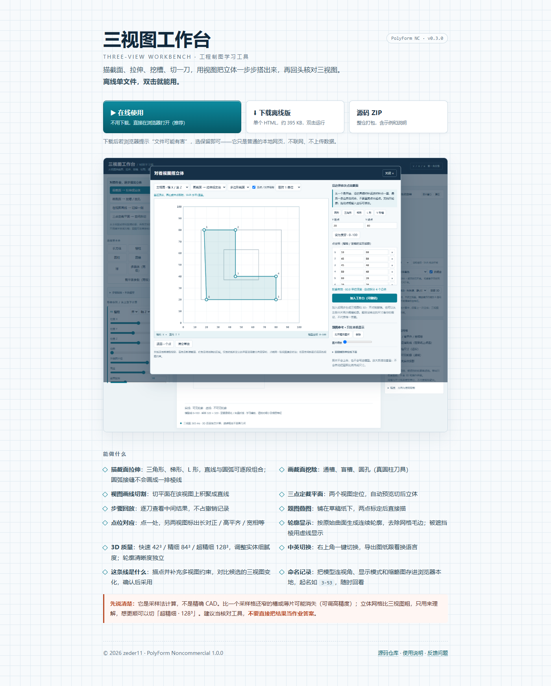
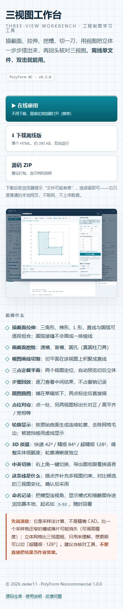

# 三视图工作台 · 工程制图学习工具

单文件、离线、零安装的**画法几何**练习工具：用基本体 + 有序布尔运算描述零件，实时生成
主／俯／左三视图（第一角投影）和可旋转的立体预览。你是在**动手把立体搭出来、再和三视图对照**，
而不是先算出角度才能操作，也不是交给 AI 猜答案。

 

## 这一版改了什么（v0.3.0）

主链路不变（手动建模 → 三视图 → 描线 → 候选比较 → 差异预览 → 采用 → 步骤回放），
这一版只解决"看不懂、只能试错"和两处手感/可靠性问题。模型格式、三视图指纹和示例保持兼容
（100 道题的三视图指纹与 v0.2.0 完全一致）。

- **几个候选同分时，直接说下一步标哪张图、哪个区域**。标完一条线后若有候选分数相同
  （最常见的是平面切削的两种方向，在同一视图里画出来一模一样），面板会找出差异最大的视图和局部区域，
  例如「这几个候选在主视图里一样，差异最大的在左视图中部」「建议在这里补一条线，能区分 2 对候选」，
  图纸上画出橙色虚线框，并给一个「在这里标注」按钮：点一下直接切到建议视图新建标注，不用手动选图。
  三张图都分不开时，会明确写「当前三视图无法区分这些构造，需要尺寸、题目文字或其他条件」，
  不再诱导学生继续描线。
- **浅弧拟合出的大半径不再被悄悄缩成小孔**。拟合半径超过基本体可构造范围（> 60，或圆心落在图纸外）时，
  这些候选会标成「超出当前基本体可构造范围 · 暂不支持」并置灰，预览会明确报错；
  不再给出一个把半径收小后算出来的、匹配度偏低的候选。普通直线标注和正常半径圆孔不受影响。
- **立体预览拖动旋转不再拖到极限就卡住**。以前上下拖动以按下时的高度为锚点、夹在 ±86°，
  拖过头再往回拖要先走完超出那段，手感像死区。现在每帧重设锚点，并把每帧的强制布局读取挪进需要的分支。
  实测反向拖动死区从 30 px 降到 0；拖动时帧间隔中位数 6.1 ms、95 分位 11.8–12 ms。
- **本机自动保存失败会提示一次**：「本机自动保存失败，请用「导出模型文件」导出 JSON 备份。」，
  同一次会话只提示一次，不再静默吞掉存储异常。
- **立体预览上方多了一排「标准视角」按钮**：主视 / 俯视 / 左视 / 右视 / 仰视 / 后视，点一下相机用 0.3 秒
  平滑转到第一角投影的六个基本方向（主视从 −Y 看、俯视从 +Z 看、左视从 −X 看……）。切换保留当前缩放、
  平移复位居中；动画途中拖动会自动打断。核对「这个方向是不是题目那张图」比拖着找角度快得多。
- **步骤回放的差异视图**：回放某一步时，青色是这一步新增的线、橙色是消失的线、紫色是实虚变化，
  面板同时给出「新增 N 条 · 消失 M 条 · 实虚变化 K 条」。导出的 PNG / SVG 不含这些彩色线，
  勾掉「与上一步的差异」可以只看干净的这一步。
- **界面减负：窄屏先看见图纸，保存和报错都说人话**。窗口宽度小于 730px 时，「添加基本体」「形体序列」
  默认收起、说明文字收起，390×844 下图纸从"要往下翻"变成首屏可见（侧栏 450px → 352px），桌面布局不变。
  「保存模型 / 打开模型 / 记录」改名为 **导出模型文件 / 导入模型文件 / 本机记录**，工具栏多一行安静的
  「已自动保存到本机 · 20:31」（成功不弹窗）。导入失败等问题改为**驻留**的红色提示条，写清原因与
  「当前模型未改变」，手动关闭或改对后才消失；成功提示仍自动消失。「多面体」「截平面参数」收进「高级形体」，
  面数说明收进折叠区；参数改用「X 位置（左右）/ Y 位置（前后）/ Z 位置（上下）」，「并 / 减」改为「加料 / 挖除」。
  本轮不改几何算法、不改模型格式、不改配色，功能与操作习惯保持原样。
- **Delete 删的是「这一步」**：草绘凹轮廓内部拆成若干凸块、列表里合成一张卡时，`Delete` 会整组删除并提示「已删除这一步」；普通基本体仍只删自己。草绘组卡与三点截平面卡现在也有选中描边。
- **清空模型先确认，换示例可撤销**：模型非空时选「清空模型」会先问一次；载入示例替换了当前模型时，底部提示「已替换当前模型」并带「撤销」。
- **查看本步：每张卡片都能把三视图跳到这一步**。形体卡、草绘卡、截平面卡名字旁边都有「查看本步」，点了三视图跳到这一步并自动打开「与上一步的差异」（新增青色、消失橙红、实虚变化紫色），横幅右端一键「返回最终模型」；窄屏点完自动滚回图纸。点卡片本身不会触发，避免拖参数误触。
- **草绘没加入前关掉要先问**：已经画了点但没点「加入工作台」时，点「关闭 ×」或按 `Esc` 会提示「当前草绘还没有加入工作台，关闭后这次的改动会丢失。」，可选「继续编辑 / 丢弃并关闭」；空白草绘不拦。
- **英文界面补全**：切到 EN 后，`title` / `aria-label` / `placeholder` / `alt` 这些看不见的文案也翻了 70 多条，滑块标签带 `slider` 语义，实时提示与 3D 说明整句翻译，不再出现半中半英或 `supersamplingon` 这种粘连。
- **出错不再丢成果，窄屏和草绘台都告诉你下一步点哪儿**。保留成果类错误（自动保存失败、导出失败、
  本机记录打不开）不再用几秒就消失的提示，而是留在工具栏下方的红条里，并给出「导出备份」按钮可直接导出 JSON；
  导出失败会说清「模型还在，可以再试一次」，记录打不开会说「记录未载入，当前模型未改变」。
  窄屏下添加形体后，成功提示旁多一个「修改尺寸」，点一下自动展开「形体序列」并聚焦到那张卡片。
  草绘台主按钮上方只显示一句当前该做的事（「还差 2 个点」「第 2 步：点圆周方向」「轮廓已闭合，可以加入了」），
  按钮不能用时直接说明原因。窄屏工具栏分成「文件」和「图纸与导出」两块折叠区，撤销/重做与「这条线是什么」始终可见。
  文案也统一了标点与说法（不再出现「。；」，统一说「当前模型未改变」）。
- **草绘可以反悔了：`Ctrl+Z` 只撤草绘点，清空和预设也能撤回**。草绘台有自己的撤销栈（底部「撤销 / 重做」按钮、`Ctrl+Z` / `Ctrl+Shift+Z`），
  弹窗打开时快捷键不再改动后台模型步骤；清空草绘与五个预设执行后会给出「已套用 L 形 · 撤销」的提示条。
  草绘点的外观不变，但命中区放大到约 24×24 像素，拖动时高亮当前点与对应坐标行，在点附近按下不会误加点。
  「这条线是什么」的标线点可直接在图纸上拖动（松手仍会吸附），面板里也能只删掉某一个点。
  窄屏下提示紧跟图纸，底部常驻「退回一点｜加入工作台」操作条，静态画法说明折成可展开的「画法说明」。
- **上下旋转从 ±86° 放开到 ±90°**：原来竖直角度夹在 ±1.5 rad（85.94°），差 4° 到不了正上方/正下方；
  现在夹在 ±π/2，手动往上拖也能停在正上方，基向量不退化、无闪烁。仍然不允许翻越极点继续转
  （越过极点只是上下颠倒的同一画面），要看背面请点「后视」。

## 上一版改了什么（v0.2.0）

改进了立体轮廓，并新增命名记录、中英切换和标线候选比较。三视图几何内核、模型格式和示例保持兼容（100 道题的三视图指纹与基线完全一致）。

- **圆口与切口轮廓重写**。直接从模型曲面生成交线、按原始几何判断遮挡，去掉体素小边造成的梳齿、横档和断口。
- **透视轮廓的虚线重写**。沿曲线累计投影弧长分布，缩放和旋转时保持清楚的虚线节距。
- **虚线相位沿折线连续**（本版修订）。首版每条网格小段都从 0 起算，密网格上会变成密集短横、缩小后
  看起来像实线；现在相邻段共享累计弧长，长棱、圆弧、孔口都是一条连续的虚线，接缝处还做了半线宽补口。
- **被遮挡的棱更容易看清**：颜色加深（#66808C），线宽从 1.35 px 提到 1.5 px，节距 12 px（实 7 空 5）。
- **实体深度缓冲优先用 24 位**（WebGL2 可用时），WebGL1 回退 16 位；轮廓遮挡独立使用原始几何求交。
- **3D 质量多了「超精细 · 128³」**（约 29 万面），实体曲面更细腻；代价是重建要几秒。
  轮廓清晰度已独立于网格精度。自动模式保持不变（先 42³ 快速出画面，空闲后升 84³）。
  把立体放大到整窗时会自动补到当前质量档。
- **新增「记录」**：把当前模型、立体视角、显示模式和一张缩略图，按你起的名字（比如 `3-53`）
  存在这台电脑的浏览器里，之后点一下就能回到当时的样子。只在本机，不联网、不上传；
  想带走的模型仍然用「保存模型」（v0.3.0 起叫「导出模型文件」）导出 JSON。
- **新增中英切换**：右上角 `EN` / `中文` 按钮，随时切换整个界面，选择记在浏览器里；
  导出的 SVG / PNG 图纸也跟着切语言。模型文件和 JSON 格式不受影响。
- **完善「这条线是什么」**：直接在视图或本地题图上描点，可区分实虚线并补充其他视图约束。
  比较平面切削、矩形槽、正向／斜向圆孔、圆柱加料和球坑等候选，先看三视图的新增、消失和实虚变化，
  支持小范围拟合参数，点「采用这个候选」才写入模型。圆弧由全部描点拟合，预览不会更改原模型。
  匹配度只反映已标注的证据；未标视图仍需人工核对，也不代表唯一答案。
- **草绘截面支持逐段圆弧**：画完点以后每一段都能单独切成「圆弧」并填弦高，拉伸、挖槽、挖孔都能用它做出
  "一边直角、一边圆弧"的形状。
- **圆弧截面的分层线已修复**：按草绘记录识别连续曲面，二维图纸和三维轮廓不再逐条显示短弦接缝，真实折角和切口保留。
  清空／换预设会清理旧圆弧，保存时保留弦高精度；材料仍为短弦近似。可用「打开模型」（v0.3.0 起叫「导入模型文件」）载入 `examples/rounded-profile.json` 查看。
- **标注与题图随模型保存**：标线面板里描的线与叠在视图上的题图会写进模型 JSON 的可选 `annotations` 字段，
  刷新、「记录」条目、重新打开模型都会还原；没有标注时不写这个字段，老文件不变。导出的 SVG / PNG 仍然只含投影线。
- 修好了开发树里三个自测脚本写错的路径（不影响发布包）。
- **拖动滑块时即时预览**：改尺寸先按低分辨率草稿出图（约 0.2 s 一张），松手后再按当前精度精算。
  实测一次 0.65 s 的拖动，旧版全程只刷新 1 次、新版刷新 4 次，松手到精确图没有变慢。
- **快捷键**：`Ctrl+S` 保存模型、`Ctrl+O` 打开模型、`Ctrl+Z` / `Ctrl+Y` 撤销重做、`Esc` 关闭面板；
  点一下形体卡片选中后按 `Delete` 删除该形体（焦点在输入框里时不触发）。
- **界面减负**：右栏「图纸辅助」折成一行，标题旁直接显示当前开着哪几项；提示字号和按钮尺寸放大到触屏可用。
- **很小的弧度也能拟合圆弧**：三点描出的缓弧（半径远超零件尺寸、圆心落在图纸外）不再被当成直线；
  选了圆弧但三点共线时会说明原因。
- **高精度采样可取消**：切到 640² / 960² 时状态栏显示「上次约 X 秒」并出现「取消」按钮，不必干等。
  题图新增「自动对齐到轮廓」，按图纸线框自动贴到模型视图的外包框上。
- 在 Firefox 上做过一轮冒烟测试（10 项全过）；此前只在 Chromium / Edge 上验过。

## 为什么做这个

学制图时真正卡住的地方不是"不会操作软件"，而是：

- 看着三视图，脑子里拼不出立体；
- 知道要切掉哪个角，但不知道怎么表达这个斜面；
- 画完不确定对不对，又没法快速验证。

大 CAD 软件太重，在线建模网站又要求你先会约束草图。这个工具只做"对照三视图检查理解"这一件事。

## 能做什么

| 操作 | 用途 |
| --- | --- |
| 画截面 → 拉伸 | 三角形、梯形、L 形、V 槽或任意不自交直边轮廓 |
| 画截面 → 挖槽／挖孔 | 贯穿或指定深度；圆形会编译成真正的圆柱刀具 |
| 在视图画线 → 切掉一侧 | 切平面在该视图上积聚成直线的斜切 |
| 三点定截平面 | 在两个视图里定位三个空间点，不用自己算倾角 |
| 步骤回放 | 看每一刀的中间结果，不占用撤销记录 |
| 题图叠图 + 两点标定 | 把题目照片铺在草稿纸下方，按已知长度校准后描图 |
| 点位对应辅助线 | 点一个位置，另两张视图和立体同时标出对应点 |
| 实体／仅可见轮廓／透视轮廓 | 透视模式下被遮挡的棱用虚线画出，虚线沿棱连续分布 |
| 3D 质量：快速／精细／超精细 | 42³／84³／128³，调整实体网格细腻度；轮廓质量独立 |

## 开始使用

1. 下载本仓库（Code → Download ZIP）并解压。
2. 双击 `app/three-view-workbench.html`，这就是全部安装过程。
3. 立体预览里拖动旋转、滚轮缩放。
4. 用「导入模型文件」载入 `examples/*.json` 里的示例。

**界面支持中文 / 英文**：右上角 `EN` 与 `中文` 随时切换，选择记在这台电脑的浏览器里，
下次打开还是上次的语言；导出的图纸也跟着切。

全程离线运行：不联网、不上传、不需要服务器或 npm。除非你自己配置 AI 服务商并点生成，
否则不会发出任何网络请求。

## 已明确的限制

- **采样法，不是精确 CAD**：比一个采样格还窄的特征可能整块消失，可以调高制图精度。
- 光滑拼接处（例如圆柱接半球）可能多一条线。
- 立体轮廓按原始曲面生成并细分为折线；一般曲面相贯仍用有限采样追踪，极小、近相切或相互很近的边界仍需核对。
- 128³ 只提高实体网格的细腻度，重建仍较慢；不需要用它来清除轮廓毛边。
- 立体网格和三视图是两套独立算法，网格更粗，只作理解用。
- 已知两张视图不能唯一确定立体。本工具帮你建一个候选再核对，不宣称推出"唯一答案"。
- 可选的 AI 面板只输出基本体 JSON。"识图准不准"没有经过真实题图验证，请当作待修正的草稿。
- 模型单位是 0–100 的工作域单位，不是毫米。
- 标线候选是有限构造的局部比较，不自动识别题图或保证找到最优切法；标注和题图会随模型 JSON 保存，但导出的 SVG / PNG 图纸不包含它们。

## 关于 AI 参与

这个项目由一名学生在工程制图学习中发起：需求、使用场景、哪一步难用以及最终取舍都由我决定，
并用真实作业检验；**大部分代码由 AI 辅助编写**，通过几何断言、100 个模型的投影指纹回归和
无头浏览器交互测试来验证。测试脚本在开发目录里，不在本发布包内。

## 许可证

**PolyForm Noncommercial 1.0.0**，见 [LICENSE](LICENSE)。版权所有 (c) 2026 zeder11。

- 可以：个人学习、教学使用、修改、二次创作、免费分享（须保留 LICENSE 里的 `Required Notice` 一行）。
- 不可以：任何商业用途 —— 转卖、打包进付费产品、放广告或付费墙后面都不行。
- 内嵌的 FXAA 着色器保留其上游 MIT／BSD 声明，见 [THIRD_PARTY_NOTICES.md](THIRD_PARTY_NOTICES.md)，
  那部分仍按各自原许可。
- 更早的 v0.1.0 版本仍按原 MIT 许可发布。
