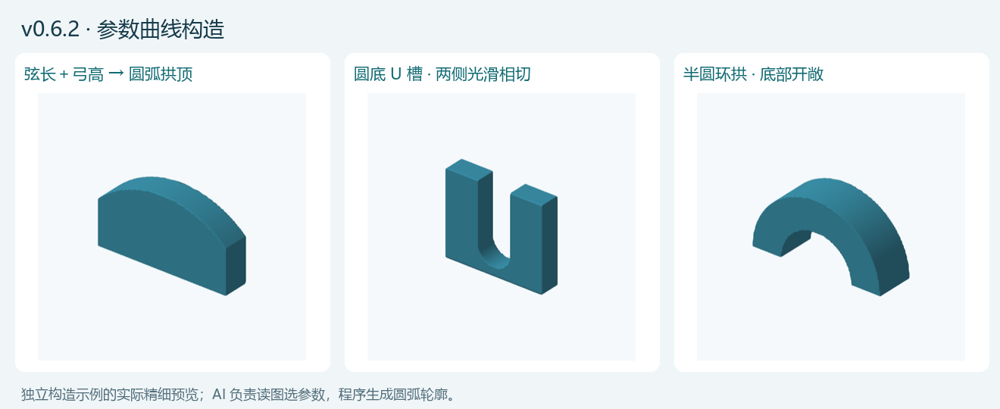

# Parameter curve construction (v0.6.2)

Direct AI generation and copied instructions for external AI include three optional sketch profiles. AI/user judgment still determines structure and dimensions. The program builds the stated geometry; it does not certify the problem answer. The interface and review confirmations are unchanged.



- `arc_cap`: `base:[u,v]` is the bottom midpoint; `width` is chord length, `rise` is sagitta, and optional `wallHeight` defaults to zero. Require width>0, 0<rise<=width/2 and wallHeight>=0. The computed roof is a circular arc, not a guessed semicircle.
- `u_slot`: `center:[u,v]` is the rounded bottom's circle centre, `radius>0`, and `top>v` is the tool's upper boundary. Only `op:"sub"` is allowed. It opens towards the positive second profile coordinate; its two sides meet the bottom circle tangentially. Set top to cover the actual opening when appropriate; a finite tool stopping inside a solid makes a pocket.
- `half_ring`: `center:[u,v]` is the common circle centre and foot baseline. Require 0<innerRadius<outerRadius. Only the upper half-annulus is constructed, with the central bottom open. Existing material from other steps may still need a separate cut.

Use `type:"sketch"`, `view`, `lo`, `hi` and one original unit throughout. V uses [X,Z] and depth Y; H uses [X,Y] and depth Z; W uses [Y,Z] and depth X. Arc-cap and half-ring profiles support add/sub/keep, with material added before sub/keep. Mixing points/arcs or rotation fields with recipe parameters is rejected.

For example, paste:

```json
{"unit":"mm","shapes":[{"type":"sketch","op":"add","view":"V","profile":"half_ring","center":[0,0],"outerRadius":24,"innerRadius":13,"lo":-7,"hi":7}]}
```

Recipes are expanded to ordinary polygon/arc inputs before existing validation, scaling and projection. Saved workbench files continue to use native-arc v4, or v6 for retention. Old model files remain compatible. Applied AI provenance stores the expanded geometry; review-range checks still guard whole input steps, not individual dimensions. Already-invalid old polygons are not guessed or silently repaired. Other directions and larger arcs use existing polygon/circle inputs.

[Arc cap](../examples/constructed-arc-cap.json) · [Open U-slot](../examples/constructed-u-slot.json) · [Open half-ring](../examples/constructed-half-ring.json)

## Finite-tool workspace limits

A slightly out-of-domain section tool may use up to 1% additional uniform scale reduction. Every operand keeps the same source centre and scale, preserving original-unit dimensions and material relationships; individual profiles are never clipped or moved. Larger overshoots still reject explicitly. Adjust the tool extent or use a suitable primitive tool. The UI shows the actual fitted span. Older builds can open the fitted geometry, but may not restore AI provenance for an example using this new fitting rule.

## Precision limits for very shallow caps

The shape relation `0 < rise <= width/2` also remains subject to the existing kernel precision limit: each arc radius must not exceed `10000000` in either the temporary normalized profile or the final workspace. This is a workspace-coordinate limit, not a radius in the original unit such as mm. There is no universal minimum rise independent of width, wall height and assembly scaling.

Construction first normalizes the complete cap profile's bounding extent to 80 units and checks its radius. The final assembly still passes the existing workspace validation. For width=60 and wallHeight=20, rise=0.0001 passes the construction check, while rise=0.00001 is rejected with a parameter-specific precision message. Successful construction does not guarantee that a very shallow curve is visible at the current projection sampling resolution.

The program never silently flattens an arc or increases its rise. A straight-line approximation requires an explicit user decision. Actual self-intersecting profiles remain invalid.
