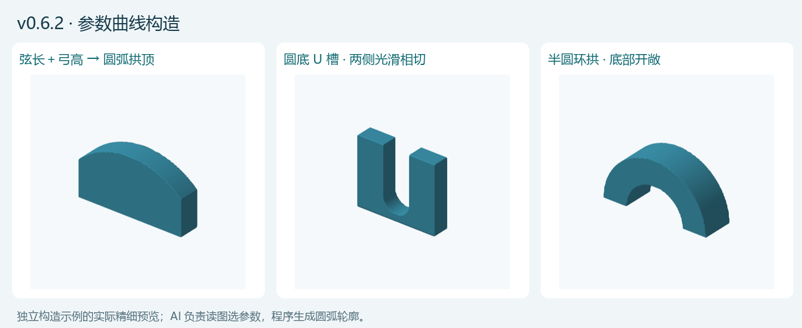

# 参数曲线构造（v0.6.2）

直接 AI 建模和「用 GPT 或其他 AI」的复制说明都已包含以下写法。模型仍需读对结构及尺寸；程序只负责把明确参数构造成有效轮廓，不保证题目已经做对。不增加界面面板或确认层。



| profile | 参数 | 含义 |
| --- | --- | --- |
| arc_cap | base、width、rise、wallHeight | base 为底面中点；width 为拱弧弦长，rise 为弓高；wallHeight 为直边高，可省略为 0。要求 width>0，0<rise<=width/2，wallHeight>=0。 |
| u_slot | center、radius、top | center 是圆底的圆心；top 是槽口边第二坐标，须大于 center[1]。仅 sub，槽口朝截面第二坐标正向。 |
| half_ring | center、outerRadius、innerRadius | center 是同心圆心及拱脚基线，0<innerRadius<outerRadius。保留第二坐标不低于 center[1] 的半圆环，中央底部敞开。 |

所有坐标、尺寸、lo/hi 使用同一原始单位。V 的二维坐标是 [X,Z]、深度 Y；H 是 [X,Y]、深度 Z；W 是 [Y,Z]、深度 X。lo<hi。arc_cap 与 half_ring 支持 add/sub/keep；sub/keep 前须有加料。

## 可粘贴的例子

圆弧拱顶：

```json
{"unit":"mm","shapes":[{"type":"sketch","op":"add","view":"V","profile":"arc_cap","base":[0,0],"width":60,"rise":12,"wallHeight":20,"lo":-6,"hi":6}]}
```

向上开口的圆底 U 槽：

```json
{"unit":"mm","shapes":[{"type":"box","op":"add","cx":0,"cy":0,"cz":25,"sx":60,"sy":12,"sz":50},{"type":"sketch","op":"sub","view":"V","profile":"u_slot","center":[0,15],"radius":10,"top":55,"lo":-8,"hi":8}]}
```

top 是有限刀具的上边界，必须根据题目覆盖真正槽口；上例的 top=55 已超过基体顶面 50，因此槽口向上敞开。若改为 45，则留下上方材料，形成内部圆底槽。程序不擅自把盲槽变成通槽。

半圆环拱：

```json
{"unit":"mm","shapes":[{"type":"sketch","op":"add","view":"V","profile":"half_ring","center":[0,0],"outerRadius":24,"innerRadius":13,"lo":-7,"hi":7}]}
```

半圆环仅构造自身材料。若原基体会堵住拱口，还须按题目另作减料；程序不自动切掉其他步骤。

## 兼容与边界

- 参数写法用于 AI 回答和粘贴入口；程序先展开成普通 polygon/arcs，再走原有几何校验、缩放、三视图和预览。
- 保存/导出的工作台模型仍使用已有原生圆弧格式（v4；局部保留为 v6）。旧模型继续可用，单纯曲线模型也可由支持原生圆弧的旧版本打开。参数构造本身不是旧版 AI 输入格式。
- 原始 AI 元数据保存展开后的几何输入；复核修改范围仍按原建模步骤参数比较，不增加单个尺寸锁定。
- 不能混写 points/arcs/旋转字段；参数缺失、半径关系错误或不支持的方向明确报错。需要其他方向、超过半圆的拱弧或一般曲线时，仍用已有 polygon/circle，并明确核对。
- 已经自交的旧 polygon 不会被擅自猜测成这些模板。重新生成或使用更新后的复制说明，才可采用参数构造。

[圆弧拱顶模型](../examples/constructed-arc-cap.json) · [圆底 U 槽模型](../examples/constructed-u-slot.json) · [半圆环拱模型](../examples/constructed-half-ring.json)

## 有限刀具的工作域

截面刀具略超出工作域时，可通过最多1%的整体等比微缩容纳；全部形体使用相同中心和倍率，原单位尺寸与材料关系保留，不裁剪或移动单个轮廓。更大的越界仍会明确拒绝，需要调整刀具范围或换用合适的基本体刀具。缩放信息显示实际工作跨度。旧版仍能打开拟合后的几何，但对采用新拟合规则的个例，旧版可能不恢复AI来源信息。

## 极浅圆弧的精度边界

`0 < rise <= width/2` 是形状关系，还须满足现有几何内核的数值限制：临时归一化及最终工作域中，每段圆弧半径均不得超过 `10000000`（工作坐标单位，不是原单位 mm）。因此不存在对所有宽度、高度及组合缩放都适用的固定最小 rise。

构造时先按拱顶完整截面的包围范围临时归一化到80单位，再检查圆弧半径；组合其他形体后的最终缩放仍须通过原有校验。以 width=60、wallHeight=20 为例，rise=0.0001 可通过构造阶段，而 rise=0.00001 会明确提示 rise 相对 width 过小、超出数值精度。参数可被构造并不保证它在当前投影采样中清晰可见。

程序不会把过浅圆弧自动压成直线，也不会擅自增大弓高。若题意允许用直线近似，应由用户明确决定；实际自交轮廓仍会被拒绝。
