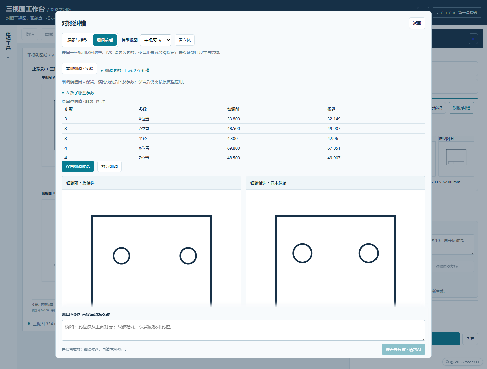

# Refine locally · experimental

Open **Compare / correct** beside the AI preview to try local geometric refinement of existing cut positions, radii/widths and depths. Built-in generation and externally pasted JSON with an explicitly attached source share the same controls. Refinement sends no AI request and never auto-applies.

## Use

1. Verify the source attached to this candidate. For external JSON, choose **Attach source**; another upload is never borrowed.
2. Open **Refinement fields** and explicitly select editable cuts and fields. Other steps and fields stay fixed. Depth is locked by default; selecting **Depth** permits the coupled axial position/tool-length adjustment while preserving the entry end. Lock fields with exact dimensions.
3. Choose **Refine locally · experimental**. Source-line preparation and geometry checking run in workers and can be stopped. Replacing the source, changing permissions, closing the dialog or switching candidates invalidates the task. Timeouts or unavailable workers retain the original; geometry is not recalculated on the foreground thread as a fallback.
4. Inspect **Refinement comparison**, switch front/left/top views and expand **Changed fields** for original-unit estimates. Discard or retain the refinement, then use the existing review/apply flow. Retaining replaces only the AI candidate; the workbench model remains unchanged.

Field locks apply only to local refinement. The cut selection shares existing review step permissions; AI revisions still use whole-step permissions. Do not interpret local field locks as individual-dimension locks on AI requests. Dimensions are not read from the drawing.

## Scope

Requires clear, recognizable, complete first-angle three-view drawings, locked axis-aligned box additions and independent cylindrical or rectangular cuts, each affecting one host. Each target must have one unique complete circle or rectangle; blind floors require evidence from both other views. Two targets cannot reuse one profile.

Missing views, photographs, isometric/section drawings, obscured profiles, intersecting stepped bores, cuts whose walls come from several bodies, later additions, oblique holes and complex booleans are unsupported. Ambiguity, conflicting locked values or a failed full-model check retains the original rather than selecting the nearest profile.

The check uses the same final-material projections as the workbench. A proposal requires all three views within the existing linework tolerance, lower residual and no detected regression. This verifies neither dimensions nor the interpretation of the problem; values are relative linework estimates.

## Saving and offline operation

Source images, masks and worker data remain session-only. After deliberate application, exported provenance may record the method and permitted fields. Import restores only a bounded record, never the source, permissions or a claim of verified dimensions. Existing workbench annotation/background exports need separate care; user-exported work should not become public examples automatically.

The single workbench HTML contains all code, without external scripts or extra services. Controlled generic examples do not establish a general accuracy improvement across arbitrary models or complex drawings.
