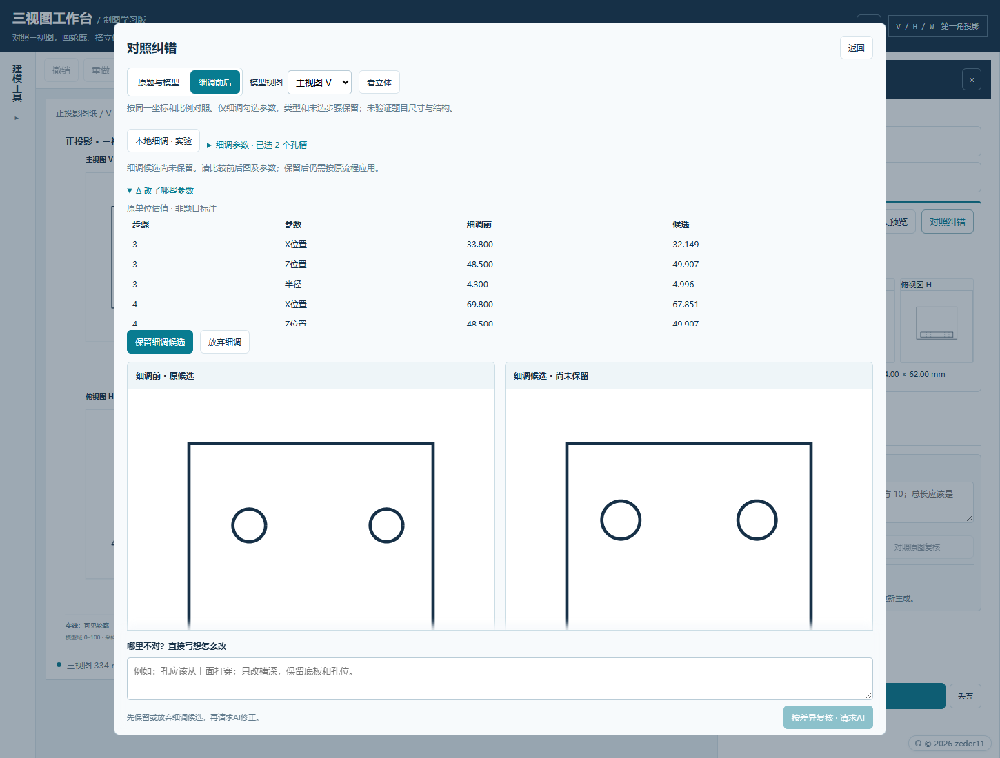

# 本地细调 · 实验

在 AI 预览旁打开「对照纠错」，可用本地几何计算尝试调整已有孔槽的位置、半径／宽度或深度。DS 内置生成和关联原题的外部 JSON 使用同一入口；细调不请求 AI，不自动应用。

## 怎么用

1. 先确认候选附带正确原题。外部 JSON 点「关联原题」；不会借用另一次上传的图片。
2. 展开「细调参数」，选择允许修改的孔槽及字段。未选步骤和字段保持原值；深度默认锁定，需要调整时明确勾选「深度」，程序一起调整轴向位置与刀具长度，保留原入口端。精确标注对应的字段应锁定。
3. 点「本地细调 · 实验」。准备线图和几何核对在后台执行，可随时停止；换图、改权限、关闭窗口或切换候选都会使旧任务失效。计算超时或后台不可用时保留原候选，不回落到主线程进行几何试算。
4. 有候选时直接看「细调前后」，切换主／左／俯视图；「改了哪些参数」按原单位列出估值。可「放弃细调」，或「保留细调候选」后按原有流程核对、应用。保留只替换 AI 候选，不修改工作台里的作业。

这些字段权限只限制本地细调。孔槽步骤选择与现有复核步骤范围同步；AI 复核仍按整个步骤的权限执行，不应把本地字段锁定误当成对 AI 请求的单尺寸锁定。原图只作线条估值，程序没有读出尺寸标注。

## 支持范围

当前支持清晰、可识别的第一角完整三视图；锁定的轴对齐长方体组合，以及各自只影响一个基体、互不相交的圆柱孔或矩形孔槽。每个目标须唯一对应一个完整圆或矩形，盲孔底部须有另外两视图印证；一个轮廓不得重复分配给两个目标。

缺视图、照片／立体图／剖视图、轮廓遮挡、阶梯孔相交、多个实体共同形成孔壁、后续补料、斜孔及复杂布尔不在本轮支持范围。无唯一对应、锁定值与轮廓冲突或全模型核对未改善时保留原样；不根据最近位置强选。

核对使用与工作台一致的最终材料投影。只有三视图均在现有线图容差内、误差下降且未发现退步，才提供候选。这不是尺寸验证或识图正确性证明；数值来自相对线条估计，不能据此宣称整题正确。

## 保存与离线

候选原题、核对掩膜和后台临时数据仅保留在本次会话。应用后模型可记录细调方法与允许字段，重新导入时只恢复受限的记录，不恢复原题或修改权限，也不会恢复任何“尺寸已验证”声明。工作台既有的标注底图导出规则仍需自行留意，用户导出的作业不应直接当成公共示例。

所有代码包含在单个工作台 HTML 中，不加载外部脚本，不需要额外服务。实验只验证了一批独立受控几何例，未证明任意 AI 或复杂题目的总体成功率。
