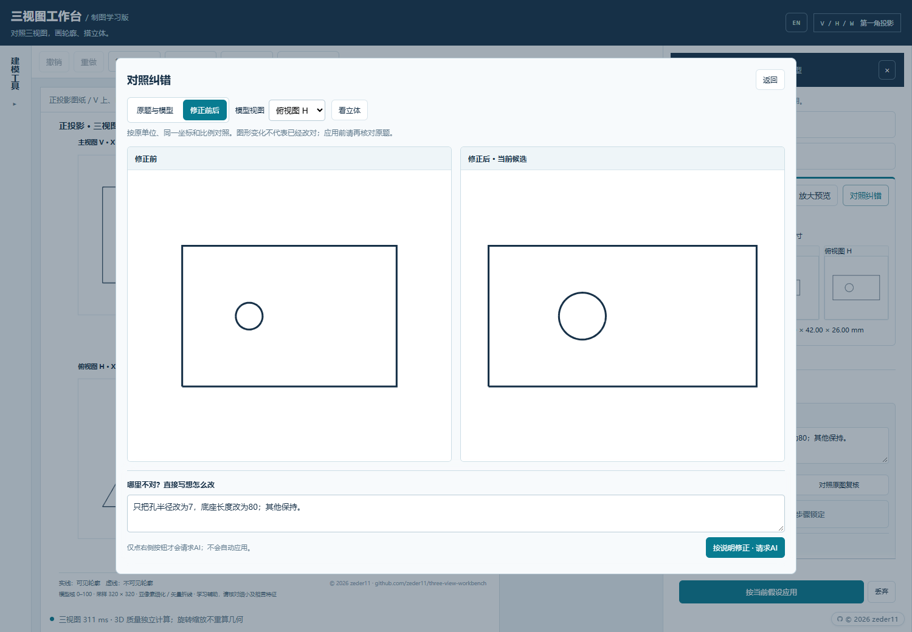
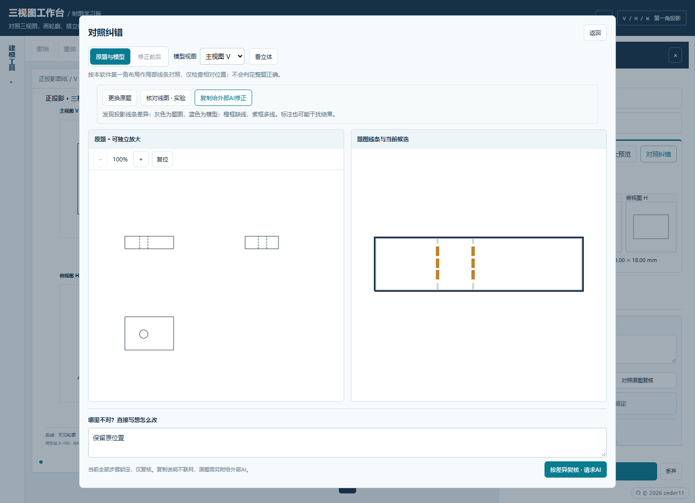
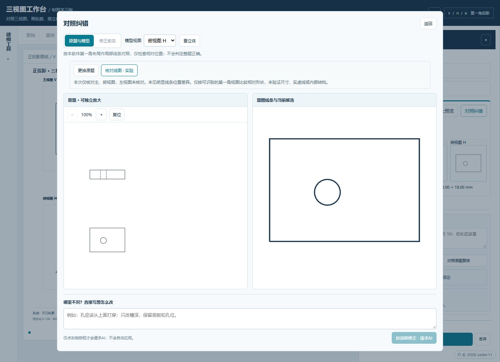
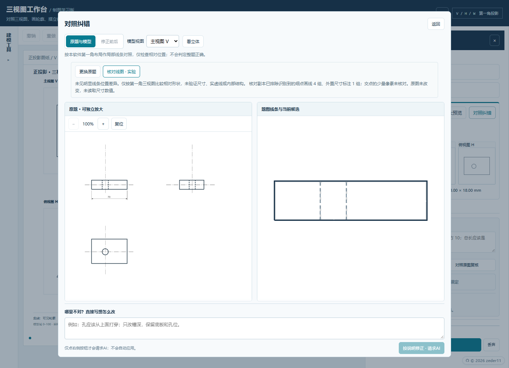
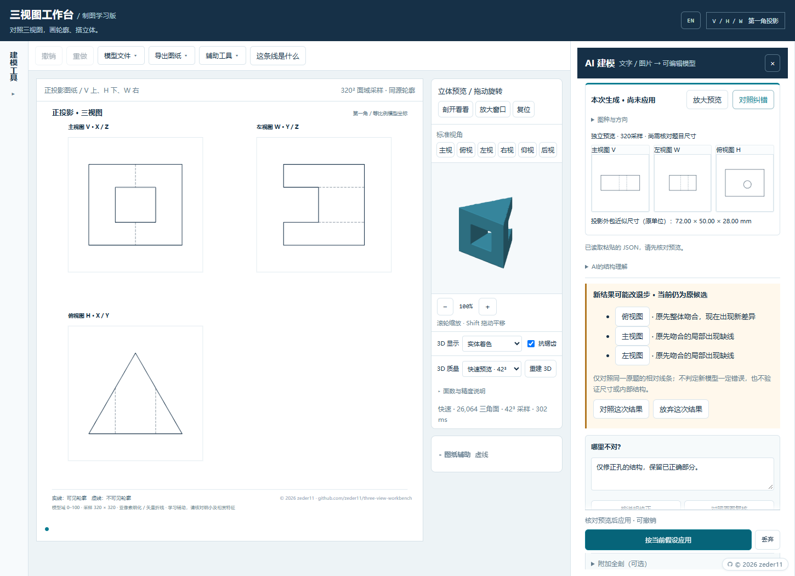

# Compare and correct

Choose **Compare / correct** beside the AI preview. Browsing, zooming and switching views run locally, send no AI requests and do not edit the workbench.

## Source / model

The left paper shows the **source attached to this candidate**; the right shows its front, left or top projection. Zoom and reset the source, then drag, touch-scroll or use arrow keys to pan. **Open 3D** opens the existing expanded preview.

The default view shows source and model side by side for manual comparison. Selecting another generation input does not replace this candidate’s source. For pasted JSON, choose **Attach source** explicitly; another upload is never borrowed. **Replace source** invalidates the previous local result. The image belongs only to the current candidate session and is not exported with the model.

## Local linework check (experimental)

With an attached source and completed projections, choose **Check linework · experimental**. Clear first-angle three-view drawings, or an upper-front/lower-top pair, are compared locally at one common scale, without an AI request, cost or extra apply confirmation. Built-in generations use their attached source; pasted JSON uses the image explicitly associated with that candidate. Both use the same checker.

Grey is source linework, blue is the candidate, orange boxes mark missing lines and purple boxes mark extra lines. With usable differences, the existing button becomes **Review differences · send to AI**. Review directly or add a note in the same field. Only an explicit request contacts an AI; checking never edits or applies the model.

This entry checks relative shape only, not millimetre dimensions, uniform overall scale, line styles or unique internal structure. No correctness percentage is shown, and agreement does not certify the solution.

For a two-view pair, the status explicitly says the left view was not checked. Selecting that view shows the ordinary model preview without a comparison overlay. Agreement in two views does not verify a third view or unique solid. A side-by-side pair is not silently relabelled, and explicitly selected section or isometric inputs are excluded. View roles follow the workbench first-angle convention, not OCR or arbitrary-layout recognition.

The comparison copy can now handle limited standard annotations: thin, clearly repeated centreline patterns including longer short strokes, and external dimensions with opposing arrowheads, endpoint extension lines and a separate nearby label. The uploaded original is unchanged. Labels are treated as text regions; their numeric values are not read or verified.

A style already established elsewhere on the page can help identify sequences interrupted by crossing contours; sufficient repeated long/short evidence is still required. Structural outlines, tangent arcs and uniform hidden dashes remain evidence. A few uncertain crossing pixels are excluded with an explicit warning; excessive uncertainty in a local outline stops comparison. Thick enlarged source strokes receive a bounded pixel-tolerance adjustment, which cannot verify differences smaller than the line width.

Indistinguishable stroke weights, boundary overlap or uncertain layout, scale and edges retain the fallback preview. Unconfirmed long/short styles, solid axes, interior dimensions, arbitrary photos, dense annotations, watermarks and reliable OCR remain unsupported. Not every unsuitable image can be recognized; treat the output as advisory.

Stop with the same button; Back cancels immediately. A late callback cannot write results after the dialog closes. Replacing a source or candidate invalidates old results, and a timeout can be retried. Attachment accepts clear raster images up to 8 MB and 16 million pixels; SVG is rejected. Images and local results remain outside model exports.

## Use differences for revision

**Review differences · send to AI** sends this candidate's source, its actual generated projections and the local observations. It preserves the existing **Review edit range**: when all steps are locked, it is check-only. Allow the affected steps or additions in the AI panel before requesting geometry changes. Out-of-range edits remain held proposals, not adopted candidates. The existing bounded retries remain; no new automatic repair loop or auto-apply is added.

Region windows are approximate locations in the current original-unit candidate after common relative alignment. They are not measured source dimensions, bore sizes or cutting-tool bounds. Annotations, occlusion and alignment can also explain a discrepancy, so AI must verify the source before editing. Unchecked views are explicitly listed. Replacing the source, candidate, projections or relevant geometry invalidates old observations.

**Copy repair instructions** stays offline and includes the current original-unit model, source text, correction note, edit permissions and the same observations. It excludes the API key, endpoint and image bytes: attach the source separately for GPT or another AI. Clipboard denial reveals selectable text without replacing the correction draft.

After copying repair instructions, return to **Use GPT or another AI**, paste the reply and choose **Read as this candidate’s revision**. This explicitly associates the reply offline: it preserves the source, enforces the edit range frozen when copied, then checks for new discrepancies. Later range selections do not broaden copied permissions. Invalid or incomplete JSON retains the original. Replacing the source, switching candidates or starting a new task invalidates the association.

Ordinary **Read and preview** still starts a new task without borrowing the old source or permissions. Neither path sends an API request or auto-applies. Only the explicitly associated revision path enforces copied permissions; ordinary new-task imports require fresh association and review. Copying does not alter generic new-task instructions.

## Recheck revisions and retain the previous candidate

After a valid local check of the same source, deliberate AI revisions are compared locally on return. Explicitly associated external revisions that pass the existing edit-range checks use the same safeguard. The frozen relative source alignment and tolerances are reused; no extra AI request is added.

If a previously matched view or local component develops significant new discrepancies, the original stays active and the new result is held for comparison. Notices are grouped by view; select a view name to open its before/after comparison. Discard the result or explicitly retain it after previewing. Retaining does not skip existing checks or apply automatically. Previewing or checking the general confirmation box does not clear the hold.

A better overall similarity can hide a damaged hole, so previously matched components are checked too. Small pixel fluctuations do not force a hold. Revisions without detected regression require no additional confirmation. This neither locks every parameter automatically nor establishes which solid is correct. No arbitrary parameter-lock UI was added; existing field protection for explicitly declared bore-material repairs remains.

Cancellation is available. A 20-second timeout, worker failure or unreliable comparison is labelled unavailable, never verified. A front/top source cannot verify the left view. Unsuitable sources, absent valid prior checks, out-of-range replies and stale associations are not promised regression detection; existing range/import review still applies. Source pixels, pending proposals and external associations are session-only and excluded from model JSON.

## Describe the correction

Write an ordinary-language request below, such as “change only the slot depth; keep the base and bore position.” It stays synchronized with the AI panel and survives view/mode changes and reopening. On narrow layouts, the correction area stays at the bottom while papers can scroll.

When there are no usable local differences, **Revise · send to AI** starts an ordinary text revision using the existing bounded retry policy. It uses the candidate's frozen original source and description, returns a new candidate and never auto-applies. Submission is disabled while busy or after applying.

The original AI panel text revision is not an automatic step lock; it appends current local observations when available. Difference review in the comparison window instead preserves the selected edit permissions. Use **Review edit range** for enforced permissions, or **Repair only the affected steps** for local findings. The window does not bypass existing issue or apply checks.

## Before / after

After a text revision, local-check repair or source review, compare the immediately preceding candidate with the current result. Matching source units use common coordinates and scale; differing units are shown independently with a warning. Before/after remains a comparison of the two candidate geometries; the local linework experiment does not change it.

Before/after is available only when the previous candidate's actual projections exist; no estimated drawing substitutes for them. The AI panel's previous-candidate switch and original same-plane section comparison remain. Applying remains explicit.

Snapshots belong to the current page session. They are not exported with the model, and the source image is not added to the model file. Reopening JSON does not restore this candidate history. A change in geometry is not proof of a correct solution.

## Local refinement

The same dialog offers [Refine locally · experimental](local-refinement.md). Select cuts/fields, compute in the background, then compare and retain a proposal. The normal application flow remains separate; no AI request is sent.
