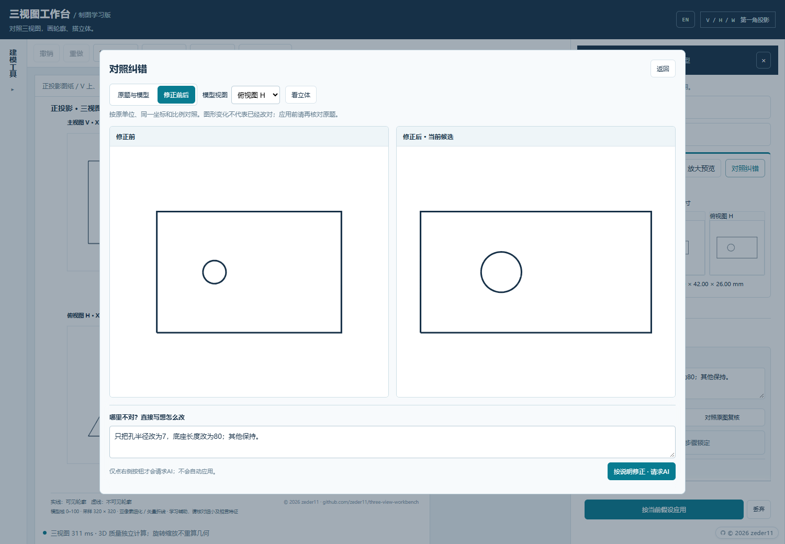
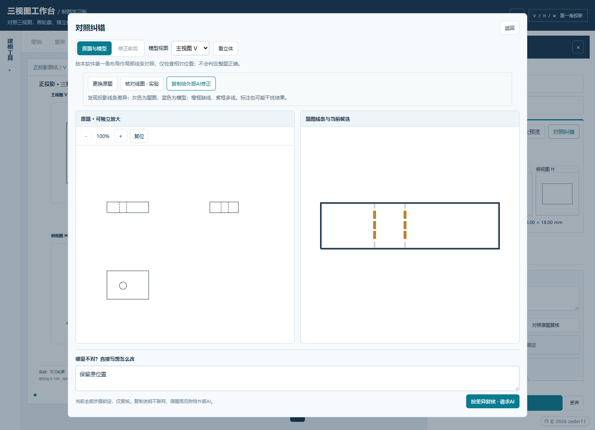
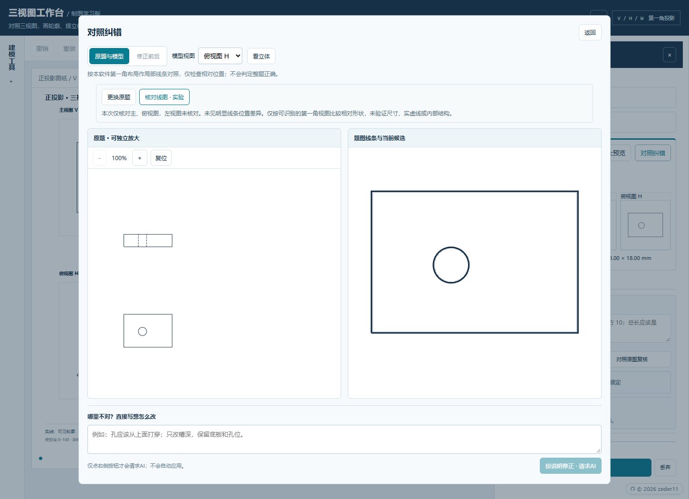
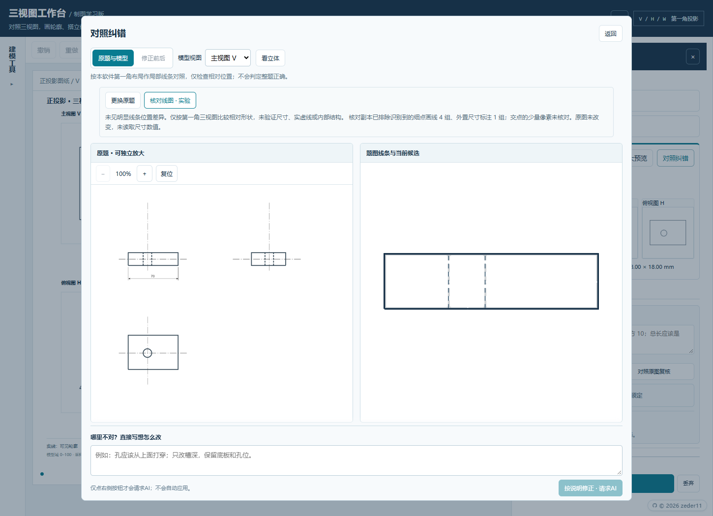
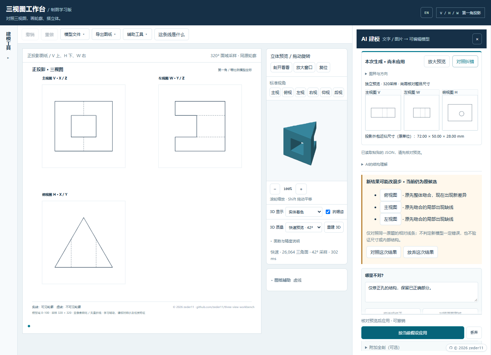

# 对照纠错

在AI结果预览旁点「对照纠错」。查看、缩放和切换都在本机完成，不发送AI请求，也不修改工作台。

## 原题与模型

左侧显示**这份候选附带的原题**，右侧显示当前模型的主、左或俯视图。原题可放大、复位，放大后用鼠标拖动、触控滚动或方向键平移。需要核对立体时点「看立体」，会打开原有放大预览。

默认并排展示原题与模型，请自行对应方向、特征及尺寸。选了另一张待生成图片，不会悄悄替换当前候选的原题。只粘贴 JSON 时可点「关联原题」明确选择对应图片；不会借用面板里另一张图片。需要替换时用「更换原题」，原有核对结果随之失效。图片仅属于当前候选会话，不写进模型文件。

## 本地线图核对（实验）

有原题且三视图预览完成后，可点「核对线图 · 实验」。它在本机识别清晰第一角三视图，或上方主视／下方俯视的两视图区域，使用统一比例对照相对线条位置，不调用 AI，不增加费用或应用确认。内置生成使用本候选已附带的原题；外部 JSON 使用你明确关联的原题，两者复用相同检查。

右侧灰色是题图线条，蓝色是当前模型，橙框提示缺线区域，紫框提示多线区域。发现可用差异后，原修正按钮显示「按差异复核 · 请求AI」，可以直接复核，也可在原输入框补充要求。只有主动点击请求才联网，检查本身不会替你改模型。

没有可信尺寸时只检查相对形状；不会判断全局等比放大是否正确，也不校验实虚线、内部结构是否唯一。当前入口不提供毫米尺寸标定，不输出“建模正确率”。未发现线条差异也不代表整题正确。

两视图时会明确标注「左视图未核对」；切到未核对视图仅显示普通模型预览，不叠加核对结果。不能把两图吻合理解为三视图或立体已正确。并排两视图不会自动当成主俯两视图；已明确选择剖视／立体图类型时不进行此项普通投影核对。第一角角色来自本软件约定，不识别题图文字或任意布局。

现在可在核对副本中处理一部分标准辅助线：明显细于轮廓、重复样式清楚的细点画线（含较长的短划），以及同时有双向箭头、引出线和外侧文字区的尺寸标注。上传原图始终保留；数字只作为文字区域，不读取或校验其数值。

线型已在本页得到证实后，可利用相同节奏识别被轮廓交叉打断的部分；仍要求足够的长短划线证据，不能仅凭一个短线段判断中心线。真实轮廓、圆弧相切和均匀虚线继续保留。交点中无法确认的少量像素不参与判断，并在界面说明；如果某个局部轮廓的不确定部分过多，则停止比较。粗线放大时按来源线宽作有限像素容差调整，不能用来验证小于线宽的尺寸差。

线宽分不清、辅助线与轮廓重合，或布局、比例、边界无法可靠确认时会退出，保留普通预览。无法证实规律的长短划线、长实线轴线、内置尺寸、一般拍照、复杂水印、密集标注和可靠 OCR 仍不在支持范围。某些不适用图片可能无法完全识别；结果只作辅助核对。

可再次点击停止检查，点返回立即取消；窗口关闭后，即使旧计算回调晚到也不会写入结果。更换原题或候选后不会沿用旧结果。核对超时可重试。图片限清晰栅格图，关联入口拒绝 SVG、超过 8 MB 或超过 1600 万像素的图片。

## 把差异用于修正

「按差异复核 · 请求AI」发送本候选原题、实际生成的三视图和本地差异说明，沿用已有的「复核修改范围」。默认全部步骤锁定时只复核；要改变几何，先在原AI面板中允许相关步骤或新增步骤。范围外的变动仍被保留为待审候选，不自动采用。沿用现有有限重试，不另开自动修正循环，也不会自动应用。

差异位置转换为当前候选原单位坐标中的近似窗口，便于定位；它来自统一相对对齐，不是从题图量出的尺寸、孔径或刀具范围。缺线／多线也可能由标注、遮挡或对齐造成，AI仍须对照原图解释来源。未核对的视图明确列出，不据此断言整题正确。更换原题、候选、投影或相关几何参数后，旧差异不再使用。

「复制给外部AI修正」离线整理当前原单位模型、原题文字、补充要求、允许修改范围和相同的差异说明；不复制API Key、接口地址或图片数据。请把原题图片另附给GPT或其他AI。浏览器不允许自动复制时会出现可全选的文本框，原修正草稿保留。

复制修正说明后，返回AI面板的「用 GPT 或其他 AI」，粘贴回复，点「读取为这份候选的修正」。这是明确关联当前候选的离线操作：保留原题，使用复制时冻结的修改范围，先检查范围，再检查修正是否把原先吻合处改差。后来放宽勾选不会扩大已经复制的权限。无效／不完整JSON保留旧候选；换题图、换候选或开始新任务后，该关联入口失效。

原来的普通「读取并预览」仍按新题读取，不借用旧图或旧范围。两种读取方式都不会请求API或自动应用。只有明确关联的修正入口才校验复制时的权限；把回复当普通新题导入时，应重新关联原题并核对。复制本身不改写通用新题说明。

## 修正后再核对，保留前一候选

在同一原题完成一次有效本地线图核对后，主动AI修正会在返回后继续做本地比较；通过原有范围检查的、明确关联的外部修正也使用同一保护。复用本次相对配准与容差，不增加AI请求。

如果原先吻合的整个视图，或吻合的局部线条出现明显新差异，旧候选先保留，新结果暂存供对照。提示按每个视图合并一行，点击视图名即可打开该方向的前后对照。可放弃这次结果，也可在预览后明确保留它；保留后仍须通过原有检查并主动应用。查看或勾一般确认框不会解除这项保护。

整体相似度变高，也可能同时改坏一个孔；因此保护还检查先前吻合的局部。小幅像素波动不强制拦截。只在发现明显退步时提示，没有退步不增加确认。它不自动锁定所有孔位或断言哪版结构正确；这次更新未新增任意参数锁定界面，已有明确孔段材料修复的字段保护保持原样。

核对中可取消；20秒未完成、计算失败或比较资料不可靠时，明确显示未完成，不能理解为已验证。两视图只检查已有的主、俯视图。原题不适用、尚未做过有效核对、范围外结果或关联已失效时，不承诺提供退步判定；继续按原有范围／导入流程核对。源图、比较像素、待对照结果和复制关联仅在本次页面会话中保留，不写入模型JSON。

## 直接写哪里不对

在下方用普通话写修改要求，例如「只改槽深，底板和孔位保持」。这段文字与原AI面板的「哪里不对」同步，切换视图、模式、关闭重开都保留草稿。窄屏输入区固定在底部，图纸可滚动查看。

没有可用本地差异时，点「按说明修正 · 请求AI」发送主动文字修正，沿用原有有限重试。它使用本候选原来的题图和描述，返回另一份候选，不自动应用。生成忙碌或候选已应用时不能从此处重复提交。

原AI面板的普通文字修正入口不自动锁定步骤；已有有效差异时会附上观察说明。对照窗口的差异复核则沿用已选修改范围。如果需要强制限制范围，使用原AI面板的「复核修改范围」；如果是本机检查发现的问题，可用「只修检查涉及的步骤」。此窗口不会绕过现有异常或应用检查。

## 修正前后

普通文字修正、检查修复或原图复核成功后，可切到「修正前后」，查看紧邻上一份候选与当前结果。原单位相同时按同一坐标与比例对照；单位不同会提示分别展示，不能直接比较尺寸。修正前后仍按候选几何比较；本地线图实验不改变两份候选的前后对照。

只有上一份候选的实际投影可用时才提供前后对照，不用估计图充当旧结果。可从原AI面板的「上一份候选」切回核对，应用仍由原按钮主动完成。原来的同位置全剖对照入口保留。

对照快照仅在当前页面会话中保留，不写入模型导出，也不保存原题图片到模型文件。重新打开JSON不恢复这段候选历史。图形有变化只表示模型变了，仍需核对题目。

## 本地细调

同一窗口现提供[本地细调 · 实验](local-refinement.zh-CN.md)。选择孔槽与字段后在后台估值，候选先比较后保留；正常应用流程不变，不请求AI。
