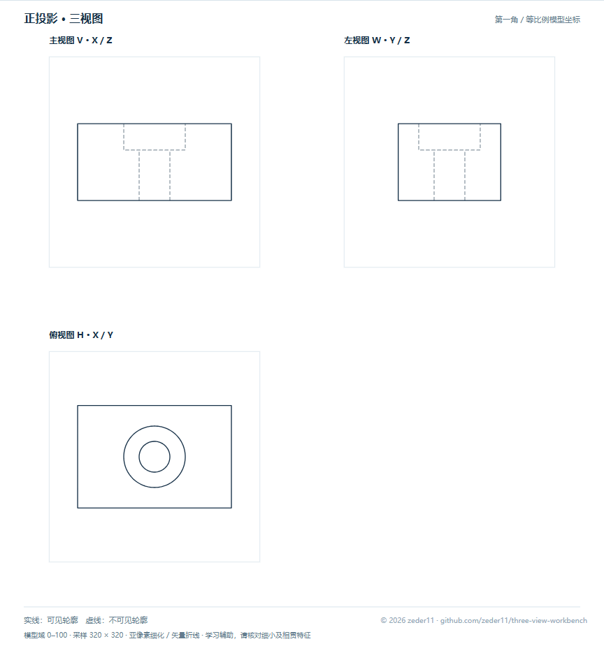
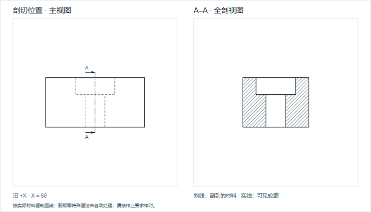

# Three-View Workbench Skill (v0.8.0)

**配套「三视图工作台 v0.8.0」的离线自检与出图 Skill。** 接入支持本地命令的 Agent 后，用户只需提供零件图或文字描述，Agent 即可自动完成：起草 CSG JSON → 离线调用工作台生成三视图、3D 预览、可选 A–A 全剖图与 DXF → 看图自查并最多返修一轮 → 空白工作台重新导入验收 → 交付带哈希绑定的成套文件。

[技能指令](SKILL.md) · [JSON 规范与曲线模板](references/schema.md) · [多模型防呆手册与 CLI](references/model-playbooks.md) · [验证范围与经验记录](references/validation.md)

## 公开合成样例实测效果

以下由仓库内独立合成样例 [04-stepped-counterbore-block.json](examples/04-stepped-counterbore-block.json)（60×40×30 mm 阶梯沉孔块）离线运行 `tvw.mjs render --section W --dxf` 直接生成：





## 多平台适配与一键安装（Codex / Antigravity / DSH）

本 Skill 遵循通用 `SKILL.md` 规范，内置 OpenAI Codex 元数据（[agents/openai.yaml](agents/openai.yaml)）与跨平台安装脚本（[scripts/install.mjs](scripts/install.mjs)），支持从任意工作目录调用：

| 平台 / 模型 | 目录 / 方式 | 说明 |
| --- | --- | --- |
| **OpenAI Codex (GPT)** | `~/.codex/skills/three-view-workbench` | 附带 `agents/openai.yaml` 界面与 `$three-view-workbench` 触发配置 |
| **Antigravity (Gemini)** | `~/.gemini/config/skills/three-view-workbench` | 官方全局技能目录，自动渐进式加载 |
| **DeepSeek Harness (DSH) / 通用 Agent** | `~/.agents/skills/three-view-workbench`（或按本机实际发现目录手动配置） | 兼容弱视觉／纯文本模型的 `--probe` + `diff` 诚实降级路径 |

```powershell
# 首次安装（自动查找 app/three-view-workbench.html 或 发布包/v0.8.0/app/three-view-workbench.html，也可显式传 --html）
node skill/three-view-workbench/scripts/install.mjs --target codex --html app/three-view-workbench.html
node skill/three-view-workbench/scripts/install.mjs --target antigravity --html app/three-view-workbench.html

# 升级已有安装（必须显式传 --upgrade：保留已有 config.local.json，并在同级目录保留可恢复备份）
node skill/three-view-workbench/scripts/install.mjs --target codex --upgrade --html app/three-view-workbench.html
```

## 快速开始

需要 **Node.js >= 18**、**Playwright**（可自动查找全局包或设置 `PLAYWRIGHT_PATH`）、**Edge / Chromium**（无 Edge 时设 `TVW_BROWSER_CHANNEL=chromium`）以及已锁定的 **Three-View Workbench v0.8.0** HTML（默认指向 `发布包/v0.8.0/app/three-view-workbench.html`，外部使用可传 `--html <path>` 或设 `TVW_WORKBENCH_HTML`）。

```powershell
# 1. 快速离线检查与空白工作台重导验收（不截图）
node skill/three-view-workbench/scripts/tvw.mjs check skill/three-view-workbench/examples/04-stepped-counterbore-block.json

# 2. 完整出图 + 原图并排对照 + 中心线 + A–A 全剖（支持世界坐标 --section-world）+ 几何点探针 + DXF 导出
node skill/three-view-workbench/scripts/tvw.mjs render skill/three-view-workbench/examples/04-stepped-counterbore-block.json --out out-demo --centerlines --section W --section-world 30 --probe "30,20,25; 30,20,10; 10,20,15" --compare source.png --dxf

# 3. 对比第 1 轮与第 2 轮正式模型改动（纯本地 JSON 对比，无需启动浏览器）
node skill/three-view-workbench/scripts/tvw.mjs diff round-1/candidate.workbench.json round-2/candidate.workbench.json --out round-2

# 4. 运行全部离线自测回归
node skill/three-view-workbench/scripts/self-test.mjs
```

## 核心约束

- **离线零外联与版本锁**：启动浏览器前先校验 v0.8.0 HTML SHA-256，运行期间拦截所有非本地请求（`networkRequests: []`）。
- **绝不伪造人工确认**：导出的 `.workbench.json` 始终保持 `confirmedReadings: {}`、`consistency.accepted: false`；未决问题与待核对读数保留在 `status: "needs_review"` 与 `report.md` 中成套交付。
- **证据哈希绑定**：`report.md` 与 `check-report.json` 记录正式模型、三视图、全剖图与 DXF 的 SHA-256，防止旧截图与新模型混用。
